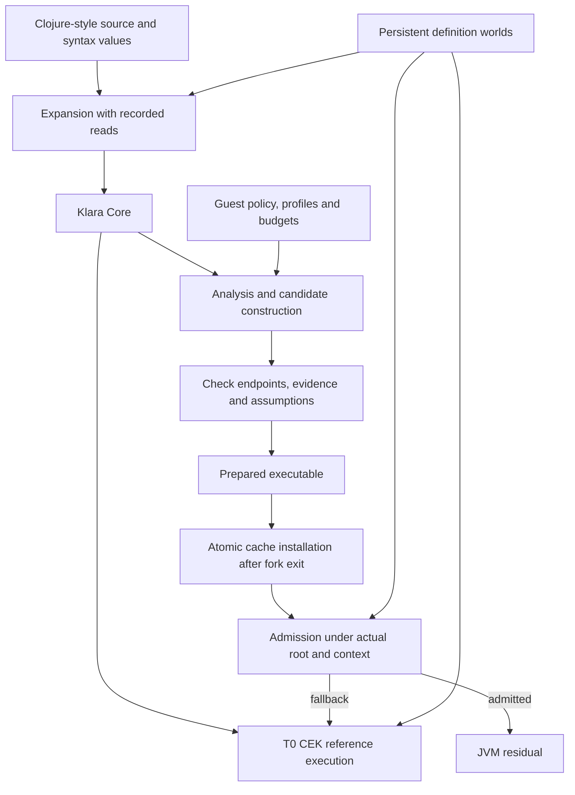

# Klara architecture

Klara's target is an independent, self-hosted language for self-organizing and
self-optimizing systems. The current implementation is hosted in Clojure on the
JVM. This document describes its working boundaries and the intended migration;
[STATUS](../STATUS.md) is the feature inventory and [objectives](objectives.md)
explains the longer-term direction.

## One running environment

Code, application state, analyses and optimizer policies should be inspectable
values in versioned worlds. A running computation retains a coherent definition
basis while another world evolves. Staging constructs candidates; a separate
admission boundary determines when a candidate may replace reference execution.
Resources and irreversible effects follow live authority protocols, separately
from immutable definition roots.

This is a shared lifecycle, not a theorem that every compiler pass is correct.
The [checked-specialization guide](checked-specialization.md) follows the actual
examples; [correctness evidence](engineering/correctness.md) identifies proofs,
tests, trusted bridges and unsupported observations.

## Implementation map

| Component | Source | Responsibility |
|---|---|---|
| Core and identity | `core.clj`, `code.clj` | Expanded syntax, staged Code, binding representation and CodeIds |
| Syntax and expansion | `syntax.clj`, `expand.clj` | Scoped syntax, grammars, macros and recorded expansion dependencies |
| Worlds and definitions | `world.clj`, `defs.clj` | Immutable roots, publication, dependency validity and early cutoff |
| Reference execution | `eval.clj` | CEK frames, closures, staged construction, handlers and compiler entry hooks |
| Live authority | `authority.clj` | Resource use, branch settlement, budgets, evidence and randomness |
| Executable cache | `stage.clj` | Candidate checks, per-root admission, runtime facts and publication |
| General compiler subset | `compile.clj`, `compile/` | Named IR, scalar analysis, direct calls, layouts, deopt and JVM paths |
| Certified fusion | `fusion.clj`, `fusion/` | Restricted elaboration, proof construction, dependency guards and lowering |
| Checked seed backend | `compile/staged.clj` | Closed scalar Code to isolated preparation and guarded installation |
| Shared private-memory path | `compile/{analysis,infer_affine,strict_fold,updates,affine_erase}.clj` | Known-helper analysis, ordered normalization, snapshot updates, ownership checking and primitive arrays |
| Deployment | `deploy.clj` | Supported source/Core/data bundles and compatible fresh-process restore |

Paths are under `src/klara/`. Experiments supply bounded
guest builders, policies and adapters around these shared components; they do
not introduce a separate statistics-specific numerical backend.

## Worlds, values and authority

A definition root contains definitions, version metadata and a reverse index
of recorded reads. A world is a replaceable reference to one such root. Forking
initially shares persistent structure; publication changes one world reference.
Versioned code does not require changing the definitions seen by old activations.

Source CodeIds and computed-value generations have different roles. Equal
expanded source can evaluate to different data through effects. Dependencies on
consumed values therefore bind evaluation generations, while source-sensitive
checks additionally bind CodeIds. A pending definition cannot silently run while
claiming a root under which its recorded reads no longer hold.

Live authority is not snapshotted by retaining a definition root. Tokens can be
consumed, transferred, partitioned and settled according to their contracts.
Discarding a branch does not refund CPU already spent or undo arbitrary host
mutation. Multi-system settlement and external effects have explicit failure
boundaries; they are not one atomic durable transaction.

See [runtime contracts](engineering/runtime.md), the [world guide](guide/02-world.md)
and [fork/authority guide](guide/04-forks.md).

## Staging, analysis and evidence

`code`, `esc`, `lift`, `run` and let insertion let programs construct executable
syntax at different times. Startup specialization and runtime re-optimization
should use the same interfaces with different available facts. Scope lifetime
and resource admission remain obligations at each boundary.

The compiler's analyses establish restricted facts about actual source: scalar
layouts, effects, helper requirements, retention and bounds. Profiles and learned
models estimate where investment is worthwhile. Mathematical rewrites and
private representations require different semantic relations. Composition must
match exact intermediate code and compatible observations, dependencies and
representation premises.

Proofs establish statements under premises. Guards check applicable current
conditions. Tests establish empirical confidence in implementation bridges.
Cost estimates guide investment. None of those roles can substitute for all the
others. Approximate statistical contracts are a separate proposed interface;
the exact speculative examples still return the reference answer on a miss.

The operational spec and T0 CEK are different implementations of the shared
fragment. Their differential tests compare observations, not step counts.
[Reading the interpreters](interpreters.md) explains the relation and open
simulation theorem.

## Compilation and recovery

The working compiler has a named intermediate form, guarded inlining, known
higher-order callback paths, selected effect lowering, scalar replacement and
Clojure/JVM emission. The checked scalar seed backend can emit a typed Java body
and load its class without restarting the JVM. Composed examples lower through
shared strict-fold, snapshot-update, ownership and primitive-array machinery.

Entry admission checks input, capture, world and handler conditions. Selected
numeric compiler paths also have interior guards with T0 frame reconstruction;
previous effects must not be repeated. That mechanism does not provide general
native continuation capture or arbitrary owned-buffer recovery. The composed
private-memory examples rely on entry fallback before candidate effects.

The target IR ladder separates Core, analysis/effect lowering, specialized
layouts and backend emission. General typed layout inference, dedicated backend
IRs and emitters beyond the JVM remain design. The JVM still supplies final
machine-code optimization. [Performance evidence](engineering/performance.md)
separates body costs from guards, scans, full calls and preparation.

## Learning, planning and operational economics

The bounded guest planner chooses among actual checked numerical/fusion/private
recipes, tracks distinct pending obligations and can evolve in a policy world.
The reference computation's world and the optimizer policy's world are distinct.
Evolving policy need not preserve the old policy's choice of plans; every
accepted residual must still satisfy its reference contract. Optimizing one
fixed policy implementation is a separate semantic-preservation operation.

The [speculative-pipelining example](../examples/staging/16-learned-speculation.md)
puts prediction, learning, residual construction and reuse/fallback policy in
Klara. Its worker adapter admits a small effect-free scalar fragment. Persistent
inputs and pinned code support larger future speculative regions, while effect
contracts and validation determine which regions are safe.

Operation, resource accounting and investment policy should form one model.
The application specifies value, budgets and constraints; forecasts decide
whether to analyze, prove, compile, train, measure or speculate. A budget bounds
investment when a forecast is wrong. Accurate predictions alone do not establish
profitability. The current planner has supplied costs, and comprehensive metering,
shared-resource coordination and learned profitability remain open.

## Persistence, portability and self-hosting

World roots currently use Clojure persistent maps. Deployment freezes only the
supported source/Core/immutable-data fragment. Datahike and other replikativ
storage adapters, potentially Geschichte history integration, remain planned.
General continuation checkpointing and provenance consolidation require explicit
formats, retention policies and authority/effect recovery rules.

Compiler builders, analyses, policies and lowering passes should progressively
move into world-managed Klara code. A small host contract must provide values,
memory, control, world publication, code loading and external interfaces. Most
of that implementation remains Clojure today; migrating a guest policy is an
implemented step, not complete self-hosting.

JavaScript, native and other useful targets are objectives. Portability needs
consistent observations, identity profiles and authority semantics, plus target
emitters and runtime services. Foreign host behavior must remain explicit at the
interop boundary. Full Clojure source compatibility is a goal, not a current
coverage claim. Languages and opt-in static layers are covered by the
[RFC index](../rfc/README.md).
