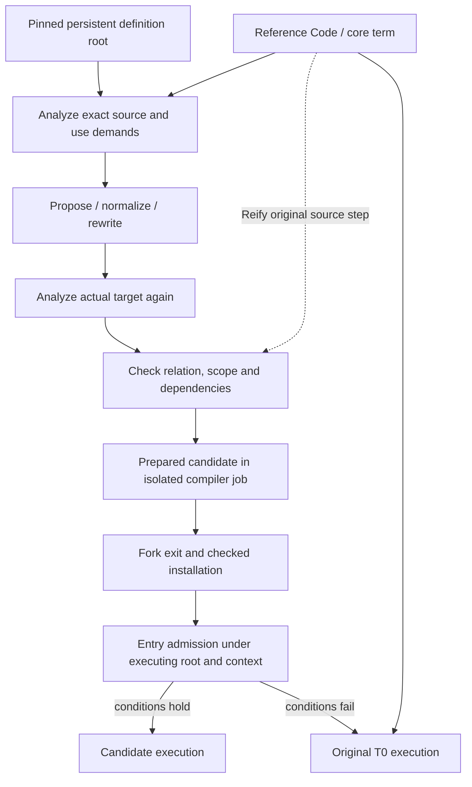
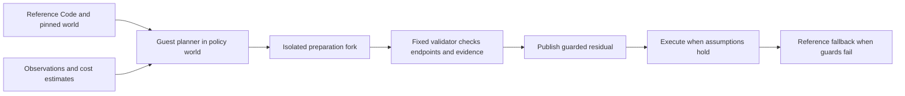

# Checked specialization: the current consolidated path

Klara has one reference computation and several ways to construct a candidate
implementation. Code generation, analysis, mathematical rewriting and profiling
are ordinary computations. They do different jobs: profiling chooses an
investment, analysis establishes facts, proof/checking licenses a relation, and
admission decides whether those conditions hold for an actual call.

The definition root is immutable. Live authority and continuation state are
separate: retaining a root does not freeze a token's current permission.
Optimized code for an old root can stay valid after a newer root changes a
definition. Entry admission checks the executing root, relevant handlers and
input layouts. These examples use entry-only fallback, before candidate effects.

## Shared vocabulary and observation boundary

Use `p` for reference Code, `rho` for actual input facts, `W` for a pinned
persistent definition root, `Sigma` for live authority, and `K` for continuation
state. Preparation budgets, profiles and candidate caches are optimizer
administration, not additional reference-language values. Each accepted edge
states an observation projection and a representation relation under these
conditions. Composing edges requires the exact intermediate plus compatible
observations and dependencies. Equality of Nat results does not by itself
preserve errors, demand, outside storage or suspension behavior.

This is the organizing interface for the implementation, not a newly proved
universal calculus. Kernel results prove their named model statements;
Core reification, T0 correspondence and JVM emission remain explicit bridges.
Proofs establish relations, guards check current premises, and profiles estimate
profitability. They are not successive strengths of one license. The
[correctness ledger](engineering/correctness.md)
maps each existing model to its actual scope and lists the missing bridges.

**Finite demand and suspension:** [example 14](../examples/staging/14-demand-and-await.klr)
constructs a lazy/eager producer and its scalar prefix fold with the same staged
builder. Whole-input totality bounds license their different forcing orders.
The adapter reuses the primitive backend and entry admission; unsafe chunk-error
motion is rejected. A separate lexical T0 await sits between completed native
calls, demonstrating pinned-world resumption with live cancellation rights.
It is not native async compilation. See [correctness ledger](engineering/correctness.md).

## One lifecycle, several evidence paths

**Mathematical composition:** [example 09](../examples/staging/09-checked-composition.klr)
uses independently selectable polynomial and traversal builders. Numeric and
fusion recipes produce kernel-checked equalities between their actual Code
endpoints; composition requires the exact intermediate. Nonnegative intermediate
bounds also have kernel evidence in a small Nat model. Preparation uses a real
authority fork, then publication follows fork exit through the existing stage
cache. Its vector executor is T0, not a newly optimized vector backend.

**Private accumulation:** [example 10](../examples/staging/10-compositional-accumulator.klr)
uses an ordinary separately defined helper and harmless local aliases. The
shared analyzer summarizes the closed helper and normalizes the caller in source
order. The existing conversion checks the expanded loop, creates private owned
storage, checks ownership and emits primitive array operations. The seed is
copied; no sampled observation licenses mutation of shared vector backing nodes.

The two paths use the same `Prepared` / install / guard boundary. Their semantic
evidence is different. Numerical equality is not the relation between a
persistent accumulator and a private buffer.

**Proof-bearing private accumulation:** [example 11](../examples/staging/11-proof-bearing-accumulator.klr)
extends example10 with optional proof admission and a persistent profile
controller. It extracts the step from original core, including lets and actual
callee bodies. Scalar-result and vector-result helpers have different checked
contracts. A generic theorem composes a step contract with the counted loop and
private-state simulation. Admission also checks the actual owned-region protocol
and proves its update callback's equation: affine validity alone would allow a
resource-safe update that computes the wrong result. This path installs the primitive-array executor;
negative or non-Long counts fall back before execution. See
[correctness ledger](engineering/correctness.md) for the remaining bridges.

**Combined native computation:** [example 12](../examples/staging/12-native-composition.klr)
composes numeric and fusion edges in either order, then lowers the actual strict
fold through the common ownership compiler. General scalar snapshot updates
replace the increment-only restriction. All RHSs read the original accumulator
before stores; captured layouts must survive backedges. A per-candidate kernel
proof joins the actual mathematical edge to a private-fold model. Core lowering,
Long correspondence and native erasure remain tested bridges. The same compiler
handles the two-slot count/sum builder, with tested evidence. See
[correctness ledger](engineering/correctness.md) for the exact scope and gate ledger.

**Producer/consumer admission:** [example13](../examples/staging/13-producer-consumer.klr)
passes identity-bound immutable facts from a checked polynomial producer to a
consumer. A kernel map-bound/weakening result supports this small abstract
domain. The consumer avoids rescanning, while retaining its current world,
handler and host dependencies. An explicit pure batch admits once and uses a
fixed unary worker; numeric batches have a primitive-return entry. Fallback
stays in the original Klara continuation. Producer output is still materialized.
See [correctness ledger](engineering/correctness.md) and its current
[measurements](../experiments/consolidation/admission-summary.md).

## What analysis currently composes

[`compile/analysis.clj`](../src/klara/compile/analysis.clj) contains shared scalar
transfer rules and a small first-order layout/retention interpretation. It
distinguishes a vector that contains an argument from a fresh Long-vector update;
tracks element facts through a known projection and branch join; and derives
helper requirements. Summaries bind actual closed bodies and must be followed
by caller layout/ownership validation. They cannot license execution alone.

Normalization removes local aliases and expands known helper calls with ordered
argument bindings. Local use demand conservatively identifies used helper
results. It is not yet a general context-sensitive escape or backward fixed-point
analysis. The loop interface and scalar snapshot-update algebra still limit the
fragment. Long-vector parameters require explicit inert layout admission. Count
results retain a distinct Integer fact; numeric equality alone cannot justify
changing the boxed type stored in a result vector.

Unknown effects, calls, capture and layouts decline. A retaining result declines
even if its helper writes nothing. Mandatory leading helper reads become exact
world dependencies and are recorded on each admitted invocation. A later read
cannot be silently moved into that prefix. On helper redefinition, old-world
specialization stays usable while the new root falls back or prepares its own.

## Evidence and its limits

| Result | Evidence | Remaining bridge |
|---|---|---|
| Horner and pure List/map/fold equalities | Existing S24 strict kernel checks | Core elaboration and execution correspondence |
| Nonnegative expression bounds and bounded evaluation | New kernel-checked monotonicity/safety theorems and per-expression witnesses | Core reification, JVM checked-Long correspondence and fold-level operational bound |
| Private-state simulation | New kernel theorem for finite scalar-cell plans, normal/failing exits, aliases and both branches | Extracting an actual core loop and proving T0/erased-array correspondence |
| Original helper/step equations and counted private composition | Kernel-checked per-term witnesses and a reusable substitution/composition theorem | Structural core extraction and actual T0/native correspondence |
| Numeric/fusion/private scalar fold composition | Per-candidate kernel proof from actual mathematical endpoints, partial-fold simulation, total-fold correspondence and fold-sum bound | Actual fold lowering, checked-Long correspondence and owned/native representation |
| Producer/consumer value facts | Kernel map-bound and weakening theorems, per-producer bounds/witnesses, identity-bound runtime evidence | Trusted producer materialization, core/JVM correspondence and guard transport implementation |
| Alias/helper normalization, ownership erasure and array emission | Recomputed derivations and differential tests | General checker and compiler soundness proofs |
| Pinned-world admission and atomic publication | Existing lifecycle plus integrated new tests | Full operational protocol proof |

The private-state model includes an unsafe retained-version instruction. The
safety proof cannot be constructed for it, and the model shows why: a source
snapshot holds 0 while an incorrectly shared cell later reads 1. This is a
semantic counterexample, not simply rejection of unfamiliar syntax.

The owned intermediate's reference execution uses
[`execute-owned`](../src/klara/compile/infer_affine.clj): fresh authority state and
finally cleanup on both success and failure. Bare interpretation of the owned
term is not that protocol. Tests check settled private tokens and an unchanged
caller store. The primitive array executor allocates no authority tokens.

Imported ansatz Init statements are loaded in TRUST mode. New proof terms are
strictly rechecked; this does not independently verify all imports, the JVM or
the whole Klara implementation. Runtime and model error/observation boundaries
are documented in [correctness ledger](engineering/correctness.md).

## Evaluation and remaining gates

The combined chain now runs as one primitive-array executable. Its
[independent-process pilot](../experiments/consolidation/benchmark-summary.md)
separates body, guards and full invocation, retains losing cases and reports
preparation costs. The input scan uses indexed primitive comparisons after the
first pilot exposed a linear allocation slope. This is one workload family;
broader evaluation and complete T0/analysis/representation proofs remain open.
Interior guards, snapshot materialization, arbitrary higher-order summaries and
continuation reconstruction remain deferred. The
[correctness ledger](engineering/correctness.md) lists the remaining obligations.

[Reproduction and evidence](../experiments/consolidation/README.md) and
[correctness boundaries](engineering/correctness.md).

## Restricted scalar and finite-driver correspondence

The [scalar proof modules](engineering/correctness.md) establish results over original scalar constructor
syntax (binary +/*, locals and strict lets), with multi-input bounds. A finite
indexed-driver theorem lifts these steps to prefix folds. General checked loops
still require a reachable-state safety invariant; a sum consumer now discharges
that premise with an explicit remaining-budget invariant. Witnesses bind actual
source and counted Core endpoints through an independently tested decoder.
These are additional model/endpoint results, not a proof of T0 CEK adequacy or
JVM emission, and they do not change runtime admission or broaden the supported
production compiler. See the new correspondence artifact for exact premises.

## Planning and evolving the optimizer

The bounded planner in
[example15](../examples/staging/15-planned-jit.klr) now implements investment
policy, recipe selection and search orchestration in Klara, with a stable host
validator and emitter. A plan tracks actual endpoints,
subject-bound facts, dependencies, outstanding obligations and cost estimates.
Planning actions include analysis, proof and measurement as well as rewrites;
these actions do not all change the program or establish the same kind of fact.

Keep the reference computation's pinned world distinct from the optimizer
policy's definition world. A new compiler job can use a newly resolved optimizer
to compile a program under an old reference world. Updating the optimizer does
not by itself invalidate already admitted residuals. Relevant semantic, input,
world, handler and trusted-backend conditions still govern those residuals.

Optimizing one optimizer implementation must preserve its stated behavior.
Evolving the policy to choose different plans is a different operation: its
outputs may differ, while every admitted candidate still has to satisfy the
reference contract. A policy cannot choose its own permissive validator.

The runnable path is:

`experiments/consolidation/planning.clj` supplies the restricted pure execution
boundary, checked preparation handler and investment controller. Pure policy
execution has a T0 transition limit; preparation is charged by elapsed time but
is not preempted at a hard deadline. Cost estimates are supplied fixtures, not
learned predictions. Different pending obligations remain different search
states. Rejections, repeat suppression and actual budget charges are tested.

The planning tests branch and merge the actual guest optimizer, publish a
checked numerical/fusion/private-array residual, and retain the old policy's
behavior under its old root. `world_evolution.clj` also exposes value-only world
entries that lack source/Core. None of this makes the validator guest-editable
or establishes a general self-hosted compiler.

## Execution and deployment boundaries

The scalar CEK model proves step preservation, a decreasing transition budget,
termination and bounded results for binary nonnegative +/*, locals and strict
lets. `scalar_finite.clj` adds scope-indexed finite environments and proves that
valid lookup and binder extension agree with the functional environment model.
Its execution witness binds the original scalar syntax and arity. Actual T0
execution and primitive emission remain differential tests, not extracted
implementations proved equal to that machine.

Definition values now receive fresh evaluation generations. Identical source
can evaluate to different data through effects, so CodeId alone cannot validate
a consumed value. Fusion certificates separately record source identity and
the generation on which the proof depends. Early cutoff retains the existing
generation only when evaluation is skipped.

`klara.deploy` freezes supported source/Core/immutable-data into a hashed bundle
and restores it in a fresh JVM with a checked host profile and an empty cache.
Stored data initializers are not rerun. Direct open top-level functions are
reconstructed; captured/pinned closures, live authority, continuations and
opaque mutable values decline. Bundles preserve logical container sharing,
numeric classes and metadata, not an arbitrary JVM heap. There is no
Datahike/Geschichte persistence adapter yet. A frozen deployment and a resumable
checkpoint have different requirements; live authority must never be cloned
by restoring data.
