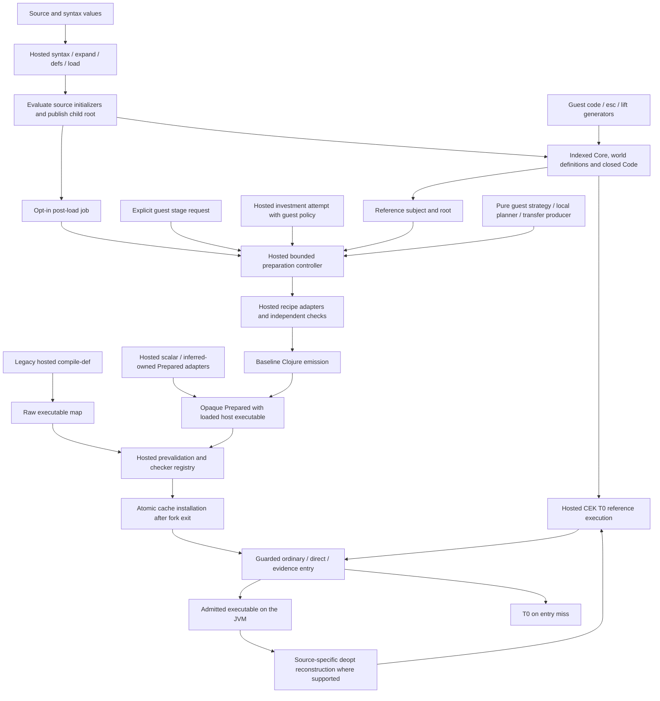
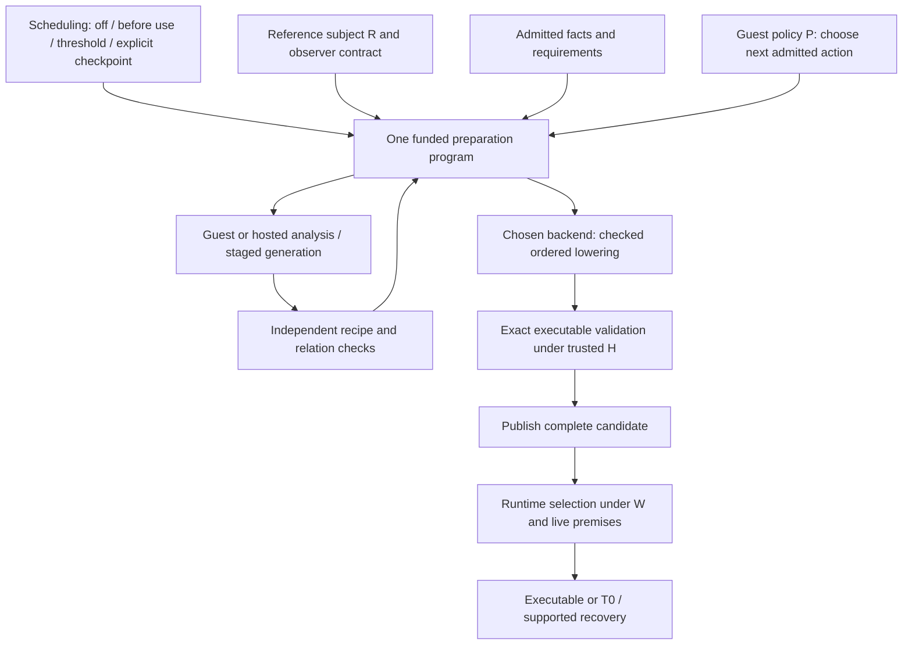

# Codebase and programming model

Current implementation map, with longer-term extensions explicitly identified.
The organizing idea is **one preparation lifecycle, implemented partly by hosted
machinery and partly by ordinary Klara programs**. Staging is a way to construct
those programs. It is not a second compiler lifecycle.

## Current organization



The arrows show responsibilities, not a single mandatory pass sequence.
[`compile.baseline`](../../src/klara/compile/baseline.clj) performs generic
admission, optional checked recipes, dependency compilation and emission.
[`compile.core`](../../src/klara/compile/core.clj) retains the earlier optimizing
pipeline; it delegates `:mode :baseline` to that backend. Scalar Java, inferred
owned and strict-fold adapters also remain present. They do not all implement
the same funding protocol. In particular, the explicitly funded request API
accepts baseline emission; legacy scalar preparation remains separate.

| Lifecycle responsibility | Current home | Who executes it? |
|---|---|---|
| Reference meaning, effects, worlds, authority | `core`, `eval`, `world`, `authority` | Hosted Clojure CEK and runtime |
| Syntax and scope-safe generation | `syntax`, `expand`, `code`, CEK staging states | Hosted mechanisms running ordinary guest generators |
| Subject and observation boundary | `compile.subject` | Hosted opaque subject; guest gets descriptions |
| Facts and requirements | `analysis`, `infer-affine`, `updates`, `requirements`, `stage` evidence | Mostly hosted checks; guest local-use proposals are independently checked |
| Sponsorship and scheduling | `funding`, `budget`, `prepare`, `investment`, loader callbacks | Hosted orchestration; investment decision function is guest code |
| Recipe choice | `strategy`, `local-calls`, `guest` | Bounded pure guest decisions; reviewed hosted/seed defaults |
| Recipe execution and checking | `local-calls`, `inline-check`, `private-accumulator`, `loop`, `relation` | Hosted adapters/checkers; transfer plans can be guest-produced |
| Lowering and host compilation | `ir`, `emit`, `scalar`, `affine-erase`, `host` | Hosted Clojure or Java generation and JVM tooling |
| Candidate validation and publication | `staged`, `stage` | Trusted hosted capabilities and checker registry |
| Selection and recovery | `stage`, `eval`, `speculate` | Hosted live guards, cached validity and supported frame reconstruction |

The staged planner in
[`klara.local-optimizer`](../../examples/compat/klara/local_optimizer.cljc),
the generated strategy in
[`klara.strategy`](../../examples/compat/klara/strategy.cljc), and the
arity-specialized transfer producer in
[`klara.compiler`](../../examples/compat/klara/compiler.cljc) are actual guest
staging examples. The default investment function is ordinary guest code,
without staging. The residual builder in
[`klara.residual`](../../examples/compat/klara/residual.cljc) uses Code views.
None makes the general hosted emitter a guest staged compiler. Edited compiler
services execute through bounded T0 with native hooks disabled, even if they
have separately prepared ordinary-call implementations. Only the exact reviewed
transfer seed has the special native shortcut.

## Separate coordinates and identities

These coordinates explain existing invariants; they are not dependent types
implemented by Klara's untyped APIs.

```text
Γ   lexical bindings allowed in a Code fragment
k   staging level: code enters k+1; esc returns to k-1
R   immutable reference root defining the optimized program
P   immutable policy root supplying compiler services for a job
W   current execution root against which runtime validity is checked
H   trusted hosted implementation and checker dependencies
C   current continuation and effect-handler context

Code[Γ]        = generated syntax with free names contained in Γ
Subject       = (Code[∅], R, observation-contract)
Request       = (Subject, P, admitted facts, allowance, recipe/backend options)
Candidate     = (original entry, residual, requirements, evidence, executable)
Prepared      = opaque process-local candidate, including loaded host code
```

`Code[∅]` discharges local scope extrusion. It can still contain world resolves;
closed Code is not world-independent. `k`, world version and definition generation
are different quantities. Changing `P` may change future preparation without
changing an already independently checked candidate's meaning. A value folded
from `R` belongs in semantic assumptions, even if the compiler read it while
preparing. `W` may be an older retained root; a displayed version number does not
replace identity/generation checks. `H` is not automatically frozen by capturing
a world root or a registry of functions.

**Open design issue: persistent phase-aware bindings.** These coordinates may
need to become related first-class data: a persistent environment should know
which code and bindings operate at which stage. Today global definitions are
keyed by symbol, without a general phase/level index. Expansion tracks staging
levels and Code carries fresh local names; globals in generated code remain
resolves, and `run` supplies its execution basis. `CodeVar` stores a level but
that field is not a general phase-aware global binding discipline. Existing
scope/level checks are therefore partial work toward this model, not its
completion. A numeric depth key alone would be insufficient: generated stage-one
code becomes present code when run, while intentional cross-stage persistence
needs its own rule. The historical stage/world diagnostic exposed loss of a
pinned closure's global context. Lifting now rejects world-dependent pinned
closures, including dependencies reached through captures; world-independent
closures remain supported. General preservation by `run(lift(v))` across worlds
is not established. See [bindings and modules](bindings-and-modules.md) for the
implemented conservative boundary and the remaining contextual linking design.

The main representations have distinct jobs: indexed Core for reference binding
and CodeId; fresh-name Code for splicing; named compiler IR for analysis and
ordered lowering; owned Core for ownership derivations; restricted proof models
for mathematical obligations; emitted forms/classes for execution. A common
lifecycle does not require a universal IR.

## Lifecycle algebra and authority

The signatures summarize the running APIs; they omit diagnostic fields.

```text
service(P, symbol, inert-input, fuel, B) -> inert-output × provenance × B'
request(Subject, P, B, options)         -> Prepared | Declined | Rejected | Exhausted
prevalidate(Prepared, H)                -> Prepared-with-validation-receipt
install(cache, W, Prepared)             -> Installed | StaleWorld
select(cache, entry, W, arguments, C)   -> Executable | T0
recover(frame-state, live-values)       -> T0-state        [supported sites only]

B -> B'                               consumed(B') >= consumed(B)
Application fork discard              does not refund B
Prepared -> prevalidated -> installed  publication is a separate step
```

Malformed requests and internal errors can still throw. Funding counts admitted
work, transitions, emissions and representation bytes; it does not preempt a JVM
compiler, primitive, native call or GC. `prepare/job` additionally groups session,
file and definition work for loader requests. Current workers are synchronous;
a fork supplies represented world/authority separation, not automatic background
execution or an isolated JVM.

For the semantic obligation, write `p ≈[R,O,A] q` to mean that reference and
residual agree under observation contract `O` and premises `A`. This is a
specification to establish, not a conclusion supplied by the notation:

```text
A(W, arguments, C) => ObsO(T0R(p, arguments, C)) = ObsO(Execute(q, arguments, C))
p ≈[R,O,A] q and q ≈[R,O,A'] r => p ≈[R,O,A∧A'] r
                                  [matching endpoint, invocation/interface, observers and transported premises]
```

Three evidence objects must stay distinct:

1. A **semantic relation** states what agreement is required, including failures,
   order, dependencies and the observation projection.
2. A **CheckedEdge** is a sealed hosted acceptance capability binding exact
   source/target endpoints to one admitted recipe. Its readable receipt is
   diagnostic data. Trusted host issuers remain part of the authority boundary.
3. A **kernel proof term** establishes a statement in its captured formal model
   and trusted imports. It proves an actual compiler step only after the decoder,
   interpretation and executable bridges are justified.

For representation changes, composition needs an explicit interface/fact/
representation transport; conjoining predicates alone does not establish it.
The chain checker enforces exact connections and contract identities. The
independent indexed inline checker strengthens actual syntax correspondence;
it does not prove the full decoder, CEK or JVM semantics. The private adapter
checks produced analysis, consumer wiring and ownership, while conversion and
native representation correspondence remain tested/trusted. Certificates remain
`:tested` on these production paths. The
[correctness ledger](correctness.md) names each proved model and remaining bridge.
Scope safety, rewrite correctness, backend correspondence and profitability are
separate obligations.

Guest `:stage/install` combines validation and publication; standalone
`prevalidate` is currently a hosted API. Validation binds the exact executable and checker-registry snapshot. Installation
checks reference-world guards and publishes atomically into the cache; application
world adoption is separate. Ordinary entry checks applicability and selects
ordered candidates. Entry misses interpret original Core; supported internal
speculation failures reconstruct checked source states. Timing-driven retirement
is a separate policy and is not currently automatic.

## Organization and remaining extensions

The following is an **ideal responsibility structure**, not a report of new
modules or a promise to migrate every hosted function immediately.



The proposed preparation program can itself become ordinary effectful Klara
code: sequence admitted operations, hold its job state, call pure analyses,
and use `code`/`esc` when specialization removes known work. Trusted checking,
authority, publication and backend primitives remain supplied operations. This
is a migration direction. Existing guest wrappers already sequence fork,
request, adopt and install; the general recipe and investment controllers remain
hosted. Cache,
registry and host compiler state are not all world-managed, and `H` is not yet
a complete first-class immutable compiler generation.

Keep the lifecycle contract small. Give each recipe an explicit subject, relation,
assumptions, proposal/check boundary and supported lowering. Move useful producer
or generator implementations into ordinary Klara definitions incrementally.
Keep semantic admission and checking authority outside editable policy.
AOT is the same preparation program scheduled before use, possibly with more
known facts. Current post-load preparation follows source initializer execution
and root publication; it prepares later function calls and cannot improve an
already completed initializer. A proposed load/initialize/start protocol would
make early preparation boundaries explicit. It can retain runtime guards; persistent native artifacts require a
separate compatibility/rehydration design. `deploy` currently freezes portable
source/Core/data and portable open-world definitions, not Prepared values or a native cache.

Explicit policies cover interpretation, fixed before-use preparation and a
cheap caller-driven threshold sponsor (`prepare/sponsor`, `checkpoint!`). The
measured `investment/attempt!` checkpoint remains a separate opt-in interface
because it needs replay and forecast inputs. No global profiler or automatic
retirement policy is installed. See [scheduling](investment-policy.md#explicit-scheduling).
Deterministic source order, work limits and recipe choice can improve control
without making HotSpot's compilation schedule or timings deterministic.

Consolidate only when contracts and at least two consumers justify it: share
ordered transfer structure, source-bound facts and publication mechanics. Preserve
the independent checker, specialized representations and T0. Funded baseline
requests are the recommended API; legacy scalar/raw entrypoints remain explicit
compatibility adapters. Trusted host edits require a fresh process. Do not infer
arbitrary host-memory isolation from
persistent roots; mutable aliases, allocation capacity and concurrent replay
need additional contracts. The [bounded allocation objective](../objectives.md#bounded-allocation-and-reusable-storage)
remains proposed beyond the current fresh private array per call.

## Reading routes and next discussion

For a PL researcher or prospective collaborator: read [architecture](../architecture.md),
[staging](../guide/05-staging.md), this guide, then the runnable
[guest local-call slice](guest-local-calls.md),
[preparation strategies](preparation-strategies.md) and
[actual correspondence boundary](actual-inline-correspondence.md).
Use [semantics](../semantics.md), [interpreters](../interpreters.md) and the
[correctness ledger](correctness.md) to separate the restricted calculus from T0.
The interesting discussion is the contract joining scope-safe construction,
versioned reference meaning, checked recipe composition and explicit scheduling.

For implementation work, follow the loader call to `compile.prepare/after-load!` or guest
`:stage/prepare-request`
into `prepare`/`staged`, then `baseline`, `strategy`/`compose`, `local-calls` and
`inline-check`, `relation`, `emit`/`loop`, and finally `stage`/`eval` entry.
Follow the private endpoint separately through `private-accumulator`,
`infer-affine`, `affine`, `updates` and `affine-erase`.
[Artifact commands](../artifact.md) cover standalone tests and verification;
`verification/consolidation/run.clj` is an active verification dependency.

The consolidation implements the agreed subject/recipe, conservative lifting,
explicit dispatch, scheduling and fresh-process host-reload boundaries. See the
[implementation map](compiler.md). General fact composition, contextual
global identity and stronger actual syntax/ownership correspondence remain the
next research seams. The [campaign evidence](performance.md)
retains short/shift losses and substantial cold/portfolio costs; it supports
cheaper explicit policy before a larger optimization framework.
