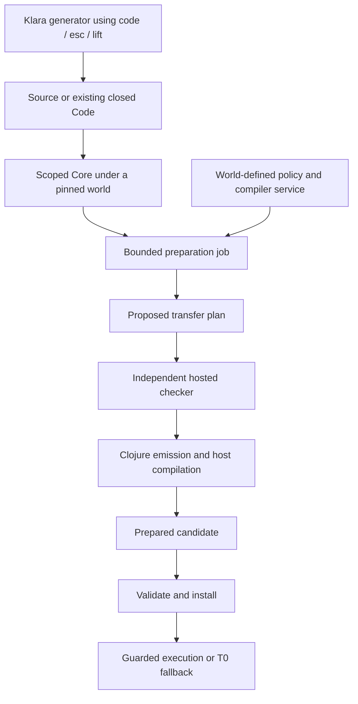
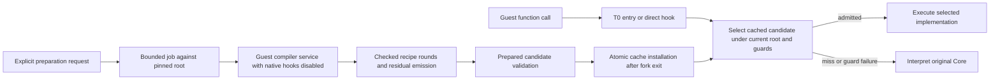

# Compiler architecture: staging, services and execution

This is the implementation map through bounded checked recipe composition.
It distinguishes mechanisms that work together from mechanisms that remain
proposed. [Preparation strategies](preparation-strategies.md) describes the
implemented subject/checked-edge/controller boundary and its restricted action
family. The [enclosed private endpoint](private-accumulator.md) composes the
local-call recipe with owned lowering under the original entry identity. The [consolidated implementation boundaries](#consolidated-implementation-boundaries)
name the current APIs and compatibility adapters.

The [preparation-cost follow-up](preparation-costs.md) separates one private
analysis producer from checking its exact source, consumer wiring, admission
metadata and ownership derivation. It reuses the candidate-local inference data;
it does not cache validation verdicts or weaken publication checks.

The [actual inline correspondence check](actual-inline-correspondence.md) now
independently checks source/residual binding and ordered helper elimination in
indexed Core. The [investment checkpoint](investment-policy.md) supplies a
bounded world-defined decision policy around measured replay, preparation and
publication. Its orchestration and forecast arithmetic remain hosted; neither
addition makes the whole compiler self-hosted or kernel-proved.

The [codebase and programming-model map](codebase-map.md) provides current and
proposed diagrams and lifecycle algebra. Its [binding discussion](bindings-and-modules.md#current-staging-support-and-an-open-world-binding-contract)
records the implemented conservative lifting rejection and remaining global
linking obligations; lexical scope safety alone does not settle them.

## One language, several responsibilities

Klara programs can generate Code, compute compiler plans, request preparation
and install checked executables. These are different operations. A function
written in Klara is not automatically a staged optimizer; a staged generator
is not automatically a correct rewrite; and a correct rewrite is not
automatically profitable.



| Responsibility | Current implementation | Contract |
|---|---|---|
| Meaning and fallback | Hosted T0 CEK, with explicit stepping | Core, effects, world/authority semantics and reconstruction |
| Syntax and staging | Hosted expansion and Code runtime; generators are ordinary Klara functions | Binder hygiene, closedness and scope checks |
| Code inspection/construction | Bounded closed-Code views, opaque cursors, guest walkers and fresh ordered templates | Read-only binding labels; original argument scopes; no implicit semantic equivalence |
| Preparation funding | Hosted job with shared session/file counters | Counts admitted work, attempts, emissions and form bytes; not wall-clock preemption |
| Transfer policy and producer | Ordinary world functions when explicitly installed; reviewed bootstrap otherwise | Bounded inert inputs, pure admitted source, stepped edited services |
| Transfer checking | Hosted `loop/check-transfer!` | Exact RHS identities, order, destinations and commit schedule |
| Optional local-call analysis | World-defined pure Klara service, including a staged planner | Bounded read-only use graph; independent use checker and fixed ordered inline recipe |
| Structural lowering | Hosted shared loop view and emitter | Validated direct entry/self-tail structure; ordered entry and transfer temporaries |
| Native backend | Clojure forms → JVM bytecode → host machine-code JIT | Checked arithmetic and admitted primitive behavior |
| Publication and selection | Prepared lifecycle and stage cache | Exact candidate validation, mandatory guards and pinned-world validity |

The lower-level trusted host API `compile-def` returns an executable. Guest
preparation uses opaque `Prepared` values and `:stage/install`; guest code
cannot manufacture a native function by returning a plan map. Loader jobs use
that same preparation lifecycle for current definitions.

## Interpreter entry versus optimizer execution

These are two paths through the current runtime:



`eval/enter-hook` and `eval/call-value` connect closure application to stage
selection. `stage/with-cache` supplies `*entry-hook*`, `*direct-hook*` and
`*context-hook*`. The direct path handles the admitted fixed-arity ABI; more
general entry selection checks real arguments and continuation context.
Installing a candidate changes cache entries, so entry-site memoization checks
that cache generation as well as the root. A miss follows the original CEK
application path. Source-specific speculative candidates can resume at checked
frame states; the baseline is not arbitrary on-stack replacement.

Compiler-service execution is an ordinary world-defined computation requested
by the preparation path, with native hooks disabled and a restricted pure
input/operation contract. Changing a planner definition changes future jobs
that resolve it in their pinned root. The existing independently checked
candidate does not become invalid merely because the policy that selected its
recipe changes. Runtime program dependencies and mutable host assumptions
still need their own validity checks.

The [runtime planner probe](../../experiments/baseline/runtime_optimizer.clj)
exercises this through the guest REPL: interpret with an empty cache; change the
planner at runtime so preparation declines; restore a planner that permits
inlining and install; then change the planner again while the already checked
implementation continues to run. This adds policy for the existing recipe.
Guest Code generation can construct new programs, but arbitrary replacement of
an existing program still needs a semantic relation, not just scope checking.

Bounded guest strategies over the local-call/private family and explicit
investment checkpoints now use these hooks. General heterogeneous recipe
strategies, automatic profiling sponsorship and public extension of interpreter
instructions remain open. The [composition contract](preparation-strategies.md#composition-contract)
records the broader obligations; [preparation strategies](preparation-strategies.md)
describes the implemented subject, checked-edge and controller boundary.

## What changed in loop execution

The baseline first admitted direct self-tail recursion through local Clojure
functions. It now uses the shared structural view to emit ordinary
`loop/recur` for directly entered loops whose self binding does not escape.
This is one structural rule over arbitrary admitted bodies and parameter
counts, not a rule for sums, recurrences or benchmark names. Other structures
retain the previous lowering or decline.

Entry RHSs evaluate in the surrounding environment into ordered temporaries
before any loop parameter is bound. Backedge RHSs likewise evaluate before
`recur` commits parameter values. The actual guest-produced backedge plan is
checked and consumed by emission. Structural checking does not establish
numeric, ownership, termination or profitability facts.

Clojure can infer primitive locals from ordinary loop initializers and use
checked primitive arithmetic. The production sum bytecode has Long locals and
`Numbers.add:(JJ)J`; its external bound remains Object-typed. Thus this first
gain does not need a speculative type guard or a new bytecode backend. JVM
machine-code generation and warmup still influence elapsed time.

This lowering was implemented in hosted Clojure. It did **not** use `code/esc`.
The staged service example below does use those abstractions. Migrating the
general residual generator into Klara is still a separate task.

T0 also supports mutual tail calls through its explicit continuation machine.
The compiled paths currently decline mutually recursive groups; ordinary JVM
recursive calls would lose bounded-stack behavior. The [wider coverage study](../../experiments/baseline/COVERAGE.md)
records that distinction and local-closure call gaps. A checked recursive-call
ABI needs a dispatch loop/trampoline and transfer/recovery contracts.

## World-managed compiler services

Two optional world definitions establish the current interface:

```clojure
klara.compiler/transfer-policy ; request -> producer symbol or :hosted
klara.compiler/transfer        ; destinations, argument terms -> plan
```

The request currently contains `:arity`, `:phase :transfer` and
`:backend :clojure`. It contains inert data, not a mutable budget handle or
authority token. A policy may select another pure source-backed world function,
choose the hosted producer, or decline. It cannot select a different checker.

`guest/bootstrap!` explicitly installs missing default definitions in one world
publication and preserves existing edits. Applications that do not install a
world policy retain the earlier reviewed seed behavior. Ordinary source loading
does not implicitly add compiler definitions.

The selected world is an explicit immutable input to preparation. A fork can
change its policy or producer and compile new kernels without modifying its
parent. The current tests cover:

| Composition | Result |
|---|---|
| Exact reviewed producer under a world policy | Reuses the native bootstrap when funded; hosted fallback otherwise |
| Edited pure producer or staged generated producer | Validated and stepped through T0 with native hooks disabled |
| Another pure source-backed function selected by policy | Admitted with its transitive definition dependencies |
| Wrong evaluation/commit plan | Rejected by the independent checker before executable publication |
| Host effect in a service | Rejected before execution |
| Diverging pure service/policy | Stops at the transition/work allowance; no candidate emitted |
| Later invalid compiler edit | New preparation declines; an already checked kernel remains valid |

`compile/service.clj` centralizes inert-data validation, pure source/dependency
admission and bounded stepping for both the policy and producer. Inputs and
outputs have node/depth limits. Counters charge validation and transitions.
The restricted source has no host effects, staging operations or authority
frames to abandon. A step allowance does not bound arbitrary time spent inside
an admitted host primitive, host compilation or GC; this is not a general
sandbox or a hard realtime service.

Only the exact reviewed producer source has a native service shortcut. A source
edit does not inherit that permission, even if its author separately prepares
the edited function for ordinary calls. A general accelerated-service contract
will need checked work bounds, metering/safepoints, or another justified budget
boundary. Merely observing termination is insufficient.

## A staged compiler-service example

[The complete guest example](../../examples/compat/klara/compiler.cljc) defines
an arity-parameterized generator with `code`, `esc` and `lift`:

```clojure
(defn transfer-code [arity]
  (code (fn [destinations arguments]
          {:evaluations (esc (records-code :evaluations arity (code arguments)))
           :commits (esc (records-code :commits arity (code destinations)))})))

(def three-code (transfer-code 3))
(def three (run three-code))

(defn transfer-policy [request]
  (if (= (get request :arity) 3)
    'klara.compiler/three
    'klara.compiler/transfer))
```

The generator removes the known-length traversal from the residual producer.
Its result contains finite ordinary constructors, bindings and indexed reads;
it contains no generator or staging operations. The same generator is tested
at arities zero through five. The example's choice of three is illustrative,
not a compiler special case.

For three destinations, direct stepped invocation takes 235 transitions for
the looping producer and 132 for the generated one, with equal checked output.
Kernel compilation records 152 transitions including the selecting policy.
These are operational counts, not elapsed-time speedup measurements.

The example's `prepare-three` uses a preparation fork and
`(perform :stage/prepare three-code {:backend :baseline})`, then installs after leaving
the fork. This prepares the service for ordinary calls through the existing
backend. Compiler invocation still uses bounded stepping. That deliberate
distinction is tested after installation.

Load the example in a guest REPL with `examples/compat` as a source root:

```clojure
(require '[klara.compiler])
:repl/code klara.compiler/three-code
(klara.compiler/prepare-three)

(def kernel-code
  (code (fn [n]
          (loop [i n a 1 b 2]
            (if (> i 0) (recur (dec i) b (+ a b)) a)))))
(def kernel (run kernel-code))
(klara.compiler/prepare-code kernel-code)
(kernel 5) ; => 13
```

Subsequent baseline preparation of a three-parameter loop uses the generated
service and records its symbol, source ID, policy ID, transitions and compiler
definition generations in `:transfer-receipts`. Guest definitions can be edited
without restarting the JVM. The backend implementation itself is still hosted.
The full sequence above runs in guest code; it needs no raw host `compile-def`
call. Compiling existing definitions through loader jobs is another entry to
the backend. General inspection/rewrite of an existing function as Code remains
an open interface, rather than an implicit ability of the generator.

## Three kinds of dependency

1. **Semantic assumptions** determine whether residual execution implements
   its subject: application definition generations, primitive roots, admitted
   handler context and layouts. They belong in guards or proof obligations.
2. **Compiler provenance** records which tools constructed a result. Here the
   independent checker fixes transfer meaning irrespective of producer code,
   so these compiler definition reads need not invalidate a completed kernel.
   They are recorded separately as `:compiler-reads`.
3. **Checking authority** determines which validation result can be trusted.
   The checker registry and opaque validation receipts are not editable world
   policy. A guest function cannot grant itself proof or installation authority.

This is not a blanket exemption for compiler reads. A constant folded from a
world definition, for example, changes residual meaning and requires a semantic
dependency. A future rewrite whose proof uses world facts must retain those
facts as assumptions. The provenance-only treatment here follows from the
particular independent transfer check.

## Before-use compilation and bootstrap

AOT is a placement of preparation before the subject runs, rather than a
separate optimizing language. Post-load preparation, explicit staged requests
and a later adaptive sponsor can use the same backend/lifecycle. Already-run
initializers do not benefit retroactively.

The reviewed producer already bootstraps through baseline compilation with
recursive compiler-service invocation disabled. This is a small seed: expansion,
scope/shape checking, T0, the independent validator and backend remain hosted.
The staged example specializes a compiler function using ordinary Klara Code.
It demonstrates part of the path toward specializing more of the compiler;
it does not make the whole compiler self-hosted or persist native artifacts.

To prevent phase confusion, preparation must always state its pinned world,
subject, known facts, allowance, output relation and publication destination.
Generator correctness, source scope safety, backend correctness and investment
profitability are separate obligations. Successful compilation of generated
code establishes none of the other obligations by itself.
Code generation performed before a preparation request is ordinary guest
computation; that later request does not retroactively meter it. The example
generator assumes a nonnegative known arity. General bounded generation and
accelerated-service work contracts remain separate obligations.

## Persistent data and performance limits

The [matched study](../../experiments/baseline/INVESTMENT.md) includes 10,000
persistent-vector updates. The promoted baseline takes 305–390 µs, Clojure
281–396 µs, SCI 528–799 µs, and T0 22.9–39.6 ms. Small vector recurrences also
run near SCI. These are specific vector workloads, not evidence for every map,
sequence or allocation-heavy application.

Those bodies use the same persistent operations as Clojure. Compilation removes
CEK work around them; it does not automatically make the accumulator mutable.
Affine conversion needs separate non-observability/ownership evidence. Likewise,
the persistent definition/world graph is distinct from the collection used by
an application. JVM GC still manages both; no world-aware custom GC is claimed.

## Remaining generalization

The [guest local-call slice](guest-local-calls.md) now connects a real analysis
to a checked rewrite and the existing preparation lifecycle. A funded
`:local-call-planner` can be supplied to a job or baseline/Code preparation.
Its compiler reads remain provenance because a fixed recipe is independently
checked; it cannot submit arbitrary replacement IR. The analyzer remains
stepped even if ordinary calls to it are separately compiled. General fact
composition and a native work contract for edited services remain open.

The [bounded composition driver](recipe-composition.md) now chains successive
local-call rounds with fresh analysis under one job budget. Stateful argument
ordering and conditional observation composition have kernel-checked model
results, with Core/binding/CEK/JVM bridges still explicit. The
[ownership family measurements](../../experiments/baseline/OWNERSHIP-FAMILY.md)
exercise captured updates, a branching recurrence and bounded histograms;
the separate owned endpoint retains its restricted observation contract.

The [bounded Code inspection and structural builder](code-views.md) supports
guest identity regeneration, literal-branch pruning and fresh ordered template
composition. A correspondence result for the supported Core fragment remains
next. Lexical scope safety does not establish the full
[module and phase binding contract](bindings-and-modules.md).
The transfer plan is one demonstrated interface,
not a universal compiler IR. Preserve ordered local bindings; automatic movement
of computations needs effect/failure evidence beyond hygienic scope.

Static annotations, inference, measured input layouts and Ansatz proofs can
be different fact producers for the same residual generator. Profiling proposes
facts; guards or proofs justify using them. Shared facts should compose across
passes instead of each pass inventing new runtime tests. No Typed Clojure
dependency or general type-inference integration has been added here.

After those boundaries are exercised, migrate more generator/analysis code into
ordinary Klara definitions, accelerate admitted services through a general work
contract, and sponsor requests from measured future savings. Keep failed work,
guard misses, world lifetime and retained code costs in the accounting. The
current policy selects a producer; it does not yet learn or estimate profitability.

## Reproduction and checks

```sh
clojure -Sdeps '{:paths ["src" "experiments" "verification" "verification/proof_staging"]}' -M -m consolidation.world-compiler
clojure -M:test
clojure -M:verify
```

The [recorded evolution trace](../../experiments/consolidation/world-compiler-results.edn)
contains source fingerprints, producer/policy generations, transition counts,
preparation work, fork selection, rejection and continued kernel execution.
Fresh runs use fresh opaque world generations; those IDs are not expected to
match byte-for-byte. The scenario writes new reports under `target/`.
The world-service milestone passed 227 tests / 6,957 assertions and verification
141 / 3,490. The subsequent [Code-view milestone](code-views.md) records the
expanded current checks. These results establish tested implementation
milestones, not complete compiler correctness.

## Consolidated implementation boundaries

`compile/core` now dispatches explicitly: `:mode :baseline` goes directly to
`baseline/compile-definition`; the compatibility optimizing path first tries
`affine-erase/compile-owned`, then the ordinary speculation/inlining/HOF/PE/
escape/emission pipeline. No load-time Var wrapper changes that routing.
Baseline does not run the owned scan. `subject/current-function` shares only
current/closed-definition admission, not ownership or rewrite certification.

`staged` shares isolation and Prepared metadata construction. Scalar Java and
baseline Clojure retain separate analyses, numeric/boxing contracts and funding.
The two-argument `staged/prepare` remains an explicit legacy scalar adapter;
new code should use funded `staged/request` with `:backend :baseline`.
`:stage/prepare` and raw optimizing REPL compilation remain compatibility APIs.
Keeping these adapters does not claim scalar compilation is metered baseline.

Guest `klara.compiler/prepare-request` sequences fork, request, adoption and
installation. A strategy chooses among checked actions; it does not choose the
checker. `strategy` and `private-optimizer` delegate this common lifecycle.
The legacy `prepare-code` wrapper still returns Prepared on success. A funded
request instead returns a normalized outcome, so those wrappers are deliberately
not conflated. Compilation never runs implicitly on every ordinary call.

`service/publish-missing!` shares ordered bootstrap publication, preserving
existing definitions with one parent CAS. Transfer, local-call and investment
wrappers preserve their return contracts. Trusted host edits require a fresh
process: namespace reload can change opaque types, seals and checker snapshots,
while `defonce` source delays/seeds can retain old code. This does not prevent
dynamic edits of world-managed guest policies under the normal checkers.

Maintained proof/model/scenario code lives in `verification/`, with unchanged
namespaces. Core regression tests run once under `:test`; the release gate runs
both `:test` and `:verify`. Archived compiler experiments have an explicit
`:history` classpath. See [artifact commands](../artifact.md).
