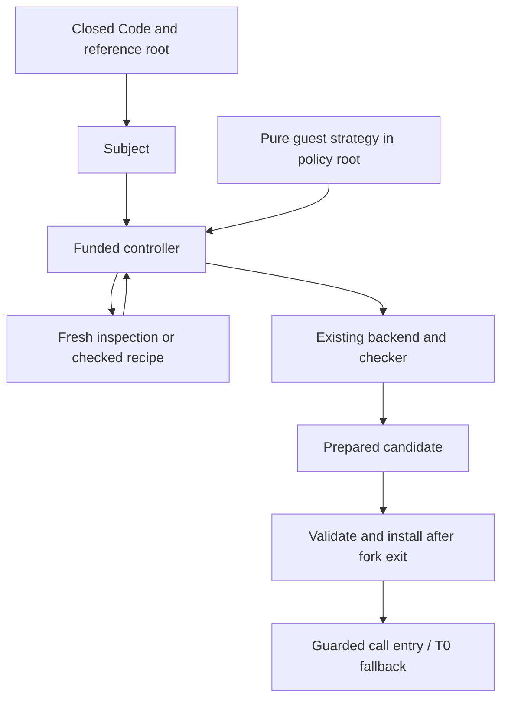

# Checked preparation strategies

The implemented preparation interface combines reference subjects, opaque
checked edges, and explicitly funded guest strategies. The
[composition contract](#composition-contract) describes their boundaries.
The initial rewrite family was local-call inlining. The subsequent
[enclosed private-accumulator endpoint](private-accumulator.md) now adds one
checked representation handoff. General ownership composition, proof-bearing
arbitrary replacements and autonomous profiling remain open. Explicit fixed,
threshold and measured scheduling are described in [investment policy](investment-policy.md).

## Execution and preparation

An ordinary call uses the installed candidate when its entry guards hold and
otherwise uses T0. It does not invoke a rewrite pipeline. A preparation request
runs a bounded controller before publication:



`code`, `esc` and `lift` build the strategy just as they build other Klara
programs. They provide scope-safe construction, not a semantic equivalence
claim. The strategy decides which admitted operation to try; an independent
adapter checks its proposal and constructs the residual.

## Runnable guest example

The implementation is [klara.strategy](../../examples/compat/klara/strategy.cljc).
In the Klara REPL, with `examples/compat` in the source roots:

```clojure
(require '[klara.strategy])
(def source
  (code
    (fn [n]
      (let [score (fn [x] (+ (* x x) 1))]
        (loop [i 0 total 0]
          (if (< i n)
            (recur (inc i) (+ total (score i)))
            total))))))
(def kernel (run source))
(def subject (klara.strategy/subject source))
(def job (perform :stage/job {:work 100000}))
(klara.strategy/prepare job subject)
(kernel 5)
;; => 35
(perform :stage/job-usage job)
```

The module generates its strategy using `(strategy-code 2)`, then `run`s that
Code. The resulting function requests inspection, up to two local-call rounds,
and finish. The example above needs only one rewrite. A nested helper requires
two rounds; the regression test checks the actual history
`[:inspect :local-call :local-call :finish]`.

`prepare` forks, requests a candidate, adopts the worker result, then installs
outside the worker. Candidate creation does not publish an executable. The
current implementation prepares synchronously; the fork is an application
state boundary, not a background scheduling guarantee.

The strategy can be replaced in the running world:

```clojure
(def klara.strategy/strategy (fn [request] {:action :finish}))
(klara.strategy/prepare job subject)
(kernel 5)
```

The new policy controls future preparation. Existing admitted candidates
retain their runtime validity independently of the policy that proposed them.
For the helper-containing source, finishing before inlining leaves an
unsupported backend form, so the second request declines; `kernel` remains
usable with its earlier candidate. This lifecycle is tested.

## Fixed interfaces and boundaries

| Object | Meaning |
|---|---|
| Subject | Closed reference Code, its reference root, and a fixed observation-contract identifier |
| Funding | Shared operational counters for work, emitted form bytes and compilation attempts |
| Strategy request | Inert source identity/shape, contract identifier, bounded history and remaining steps |
| Checked edge | Exact source/target endpoints and accepted recipe evidence, issued by the trusted adapter |
| Prepared | Existing opaque executable candidate, subject/evidence summary and entry requirements |

Strategy responses are exact maps:

```clojure
{:action :inspect}
{:action :local-call :planner 'klara.local-optimizer/planner}
{:action :finish}
{:action :private-accumulator} ; terminal enclosed-region endpoint
```

No action accepts arbitrary replacement Code, a checker, a contract override
or a host callback. Pure services run with compiler entry hooks disabled and
bounded transition fuel. The controller keeps roots, capabilities and accepted
edges; the guest receives descriptions. The default allowance is four actions,
with a maximum of eight. Legacy repeated local-call preparation retains its
two-round default and four-round maximum.

Every rewrite re-analyzes the current residual. The driver checks bounded
residual structure, exact endpoints, contract identity, receipt consistency
and cycles. Receipt maps are diagnostic data; they cannot authorize a rewrite.
An opaque edge is evidence that the trusted adapter accepted the fixed recipe,
not a mathematical proof. Trusted hosted code can create issuers and register
checkers; that remains part of the trust boundary.

The reference root fixes the program being optimized. The policy root supplies
the strategy, analyzer and transfer producer. They can differ: tests introduce
a strategy and change a callee in the policy fork while retaining the old
reference behavior. Runtime dependency guards still refer to the reference
program. A displayed world version is not a validity token.

The funded protocol currently supports only baseline emission; explicit scalar
requests decline rather than imply accounting that the scalar emitter does not
implement. `:stage/prepare-request` defaults to baseline and requires a Funding object in `:job` and returns one of
`:prepared`, `:declined`, `:rejected` or `:exhausted`, with cumulative usage.
Unsupported regions decline; invalid guest actions or recipes reject; budget
exhaustion remains charged. Malformed API requests and internal failures can
still throw. Legacy `:stage/prepare` delegates to this protocol, creates an
implicit allowance for baseline requests if necessary, and preserves its direct
Prepared return on success. Legacy scalar preparation retains its separate,
unmetered endpoint and normalized declines. The trusted host `staged/prepare` API still throws on decline.

Funding is operational state shared across requests and forks. Discarding a
worker does not refund its work. Creating another job explicitly sponsors
another allowance; this is not yet a global autonomous investment policy.
Native compilation has charged attempts/bytes and admission bounds, not hard
wall-clock preemption.

## Observation and memory limits

The exposed identifiers describe existing **experimental observation
projections**, not full Clojure contextual equivalence. Prepared information
states this explicitly: unrestricted host identity, arbitrary metadata and
complete semantic proofs are not established. The request API refuses
caller-supplied observation maps or weaker contract overrides; asking for an
unsupported stronger contract declines. This prevents policy from silently
changing its requested contract, but does not complete the missing semantic
bridges or enforce a whole-language observation discipline.

For example, `(fn [x] x)` through the scalar Java endpoint preserves Long value
and class but may rebox, losing identity with an input outside the JVM cache.
Generic baseline emission can also reconstruct a literal rather than preserve
its reference object. A scalar output alone does not erase all host identity
observations. The legacy escaping-vector owned endpoint therefore remains separate. The new
[enclosed endpoint](private-accumulator.md) restricts its consumer to pure
boolean-producing syntax; it does not permit escaping vectors or arbitrary
identity observers.

Guards establish premises; the recipe checker or proof must justify a rewrite
under those premises. A persistent world root does not isolate a reachable
host atom. A mutable-memory invariant needs a capability/lifetime contract
throughout execution, not a successful alias check at entry. The new metadata
reports that host-alias isolation and replayability are not established.

## Measuring a candidate in a fork

[fork_benchmark.clj](../../verification/baseline/fork_benchmark.clj) demonstrates
the separate profitability step for an admitted pure subset. It admits exact
inert inputs and a pure reachable source/dependency closure, then requires a
fuel-bounded reference execution to complete. An opaque Counted input, a host
atom effect and a nonterminating reference are negative regression cases.

Only after admission does it prepare and validate a candidate into a private
cache. Every reference/candidate trial uses a fresh application-world fork
and authority store. It checks equal results, unchanged roots and actual
compiled hits. Work sponsorship charges reference-transition equivalents for
both trials; this is not a measurement of native instructions.

The [recorded warm REPL cohort](../../experiments/baseline/fork-benchmark-results/repl-final.edn)
sums 100 integers. Seven alternating-order pairs after five warmup pairs gave
medians of 83.1 microseconds reference and 3.20 microseconds installed candidate;
preparation took 2.84 milliseconds. These single-call, single-process samples
are diagnostic evidence, not a performance evaluation or a general payback
estimate. The parent world/cache receives no automatic promotion. Application
forks share JVM JIT, GC, caches and clock state, so their timing is not isolated.
Arbitrary stateful replay and cancellation of native code remain unsupported.

This separation matters: a faster result never licenses an invalid rewrite.
After semantic admission, timing can inform whether to publish or retain a
candidate for future calls. V8's documented deoptimization concerns failed
speculative assumptions and frame reconstruction; its tiering manager uses
hotness and stability feedback. Timing-driven retirement is a separate policy
choice, not something we should describe as ordinary V8 deoptimization.
See [Maglev](https://v8.dev/blog/maglev) and the
[V8 tiering manager](https://chromium.googlesource.com/v8/v8/+/refs/heads/main/src/execution/tiering-manager.cc).

## Remaining generalization

One terminal owned endpoint with a checked syntactic observation boundary and
shared funding is now [implemented](private-accumulator.md). Generalizing that
boundary remains next. [Named variant priorities and common source-relation
admission](candidate-selection.md) are now implemented for the baseline adapters;
they do not install an autonomous investment policy.
The existing Ansatz composition theorems remain abstract models; freshening,
Core/CEK correspondence and JVM emission remain implementation bridges. This
change adds no theorem claiming full compiler or memory correctness.

## Composition contract

For a reference subject S at root R, preparation under policy root P constructs
successive residuals S₀ → S₁ → … → Sₙ. Each accepted edge binds exact endpoints,
the same observation contract and its own premises. Fresh analysis describes
Sᵢ, not an earlier residual. A shape fact must name its subject, interface and
lifetime; a profile observation only proposes a fact. Entry guards, independent
checks or proofs justify its use. Product-like combinations need compatible
facts and ownership; alternatives preserve each candidate's own requirements.

Keep provenance π, semantic dependencies D, evidence E and proof context Θ
separate. A compiler-service read may be provenance when an independent checker
makes the result valid regardless of service implementation. Folding a world
value creates a semantic dependency. Proof hashes without their assumptions
and definition context do not establish validity in another world.

Scope/phase checks belong to Code construction; relation/ownership checks to
preparation/publication; remaining applicability checks to entry. Repeated body
checks can disappear only when immutable roots, layouts, ownership and effect
contracts keep their premises stable. Bounds and overflow required by the
source remain unless separately discharged. Unknown host mutation or reentry
may require more checks or rejection.

Private mutation starts from fresh storage or an established exclusive
capability, never an observed lack of aliases to a persistent backing store.
All update RHS computations finish before stores. Intermediate snapshots,
unknown callbacks, escaping captures and fork-visible aliases must remain
unobservable under the admitted contract. Identity of a zero-trip vector and
scalar unbox/rebox identity are concrete limits: equal results alone do not
justify unrestricted host equivalence. Entry-only failure falls back before
source effects; a source error after effects must not restart from entry.
Interior private-memory recovery is still unsupported.

Guards must not force lazy inputs, invoke arbitrary protocols or reorder source
failure. Mutable contents cannot inherit immutable-value evidence merely from
container identity. Authority lifetimes remain live obligations across any
allowed suspension/interference. A world fork does not roll back Java mutation
or host atoms. Timed replay admission and semantic rewrite admission are
separate, even when both occur in the same fork.
