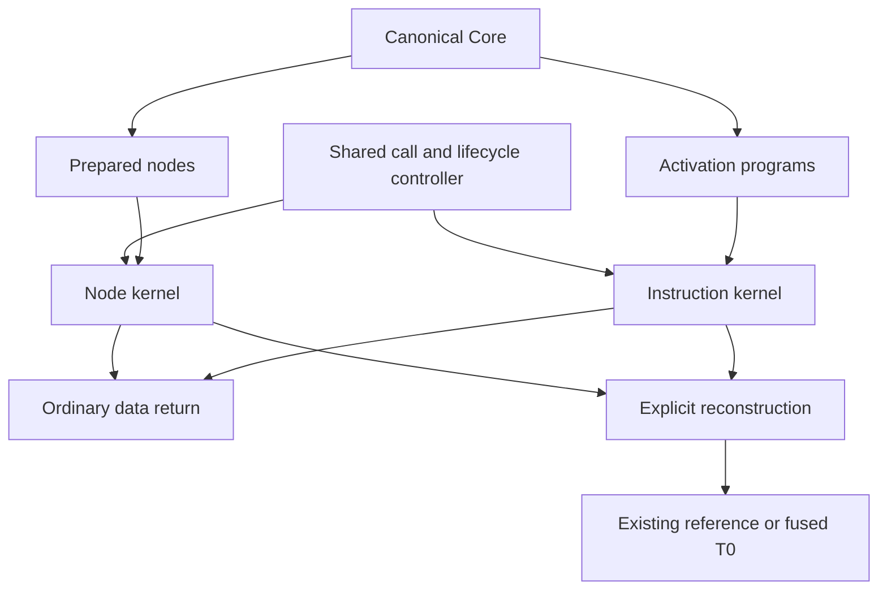

# Activation programs versus prepared CEK nodes

This compares two physical execution representations under the same experimental
controller and pure-fragment admission. It does not change the production
interpreter or select a new default.

**Decision:** keep nodes as the experimental baseline. Activation programs
improve several larger workloads, but this boxed prototype fails the proposed
general promotion gate: small calls regress after longer warmup, some
allocations increase, and recovery is more expensive. The shared controller
and reconstruction contract remain useful independently of that choice.

## One controller, multiple kernels



The prototypes share input/output admission, primitive anchors, private closure
values, source identities, code basis, decimal entry context, snapshot lifecycle
and one-use transfer/resumption. They are not two complete language
implementations: effects, staging and globals remain in T0. Completed calls
return data directly; ordinary returns do not reconstruct CEK frames.

In a host REPL with `src` and `experiments` on the classpath:

```clojure
(require '[interpreter.activation :as a] '[interpreter.bridge :as b]
         '[klara.expand :as x] '[klara.world :as w])
(def term (x/expand-expr '(fn [n] (+ n 1)) w/empty-root))
(def nodes (b/prepare term))
(def program (a/prepare term))
[(b/invoke nodes 4) (b/invoke program 4)]
;; => [5 5]
```

Both support `b/start`, `b/advance!`, `b/freeze`, `b/thaw`, `b/transfer!` and
`b/resume!`. Returning data consumes the controller lease. These interfaces
remain trusted host APIs, not an authority theorem or guest sandbox.

## Representation

The node kernel follows Core operations and keeps logical let/if/operand
frames in reusable arrays. Activation preparation emits immutable instruction
objects, direct local slots, temporary windows, branch positions and tail-call
flags. Values remain boxed; arithmetic uses the same checked Clojure functions.
There is no type specialization or emitted source-specific JVM body here.

`(let [x (+ n 1)] (* x 2))` becomes schematically:

```text
constant 1 -> t0
add n,t0 -> local-x
constant 2 -> t1
multiply local-x,t1 -> result
return result
```

There is no active let/list frame per operation. Only non-tail calls suspend
a physical caller activation. Closures copy full lexical prefixes and recursive
groups are sealed before use. Tail calls replace exclusively owned activations,
stabilizing arguments before overwriting slots, including when target captures
overlap the old operand window. The node pilot's active-frame reuse scan is
unnecessary with this activation ownership discipline.

Instruction metadata names exact Core nodes, lexical prefixes, computed values
and logical pending frames. Projection builds the node-shaped descriptor
accepted by the bridge. Primitive/call boundaries can project to T0 `:finish`.
Administrative branches/jumps may correspond to no additional T0 transition;
fuel counts backend operations, not common source steps. Layouts are simple:
no optimizing register allocation, dead-slot elimination or capture trimming.

Snapshots copy active slots and callers, sharing sealed code/captures/data.
This is not CoW, concurrent snapshotting, durable execution or general capture.

## Checks

```sh
clojure -M:memory-probe --check
```

The combined suite has 18 tests and 2,621 assertions. Activation tests pause at
each instruction in bounded programs, match reachable T0 configurations in
forward order, then resume through both T0 drivers. They cover snapshots,
recursive/higher-order calls, overlapping tail reuse, scope, numeric
representations, context, errors and leases. Generated expressions compare
both engines with Clojure. This is empirical correspondence, not an
ansatz-checked preparation/simulation theorem. Bridge restrictions still apply.

## Reproduce

Run sequentially, with other verification work stopped:

```sh
clojure -J-Xmx1g -Sdeps '{:paths ["src" "experiments" "verification" "verification/proof_staging"]}' -M -m interpreter.activation-bench 0
clojure -J-Xmx1g -Sdeps '{:paths ["src" "experiments" "verification" "verification/proof_staging"]}' -M -m interpreter.activation-bench 1
clojure -J-Xmx1g -Sdeps '{:paths ["src" "experiments" "verification" "verification/proof_staging"]}' -M -m interpreter.activation-bench 2
clojure -M experiments/interpreter/activation_summary.clj
```

Preparation is measured after five warmups with nine samples. Execution warms
each engine 40 times and measures nine alternating samples of five complete
calls. Admission, machine creation, context/lifecycle checks and result return
are included; expansion is excluded. Snapshot comparisons find matching
logical Fibonacci states with eight pending frames, rather than equating
backend instruction counts.

The [aggregate](results/activation-summary.edn), [table](results/activation-summary.tsv)
and raw reports retain hashes, JVM flags and samples. Hardware/runtime: Intel
Core Ultra 7 258V, Linux x86_64, JDK `25.0.1+8-LTS-jvmci-b01`, Clojure 1.12.4,
JVMCI enabled, 1 GiB heap. Ratios below are within-process comparisons; ranges
span three JVMs. An allocation ratio below one favors activation programs.

| Workload | Nodes/activation time | Activation/nodes allocation |
|---|---:|---:|
| Sum, 10,000 iterations | 0.87–1.54× | 1.00× |
| Local calls, 10,000 iterations | 1.22–1.26× | 0.68× |
| Vector updates, 10,000 iterations | 1.30–1.34× | 1.00× |
| Loop under a caller, 10,000 iterations | 1.31–1.34× | 0.99× |
| Small closure composition, one call | 0.37–0.39× | 0.82× |
| Non-tail Fibonacci, n=16 | 1.11–1.14× | 1.07× |
| Large capture, 10,000 iterations | 1.24–1.27× | 1.02× |

The short-run small-call case is about 2.6–2.7 times slower with activation
programs. Summation loses in one process. Warmed preparation is roughly 2–3
times as expensive: 54–262 microseconds versus 25–107 microseconds across these
programs. Preparation allocation, instruction/slot counts and raw samples are
retained. This does not establish general preparation amortization.

Matched freeze+thaw allocates 2.97 KB for activation programs versus 4.01 KB for
nodes, but takes 3.10–3.45 microseconds versus 2.80–3.00 microseconds.

## Warmup and reconstruction follow-up

Run `interpreter.activation-followup` with the same command prefix for process
IDs `0`, `1`, `2`, then:

```sh
clojure -M experiments/interpreter/activation_followup_summary.clj
```

This separate cohort warms both small-call engines 10,000 times, then takes
nine alternating samples of 1,000 calls. The
[follow-up aggregate](results/activation-followup-summary.edn) retains its own
source cohort. Nodes take 3.89–3.97 microseconds; activation takes 4.60–4.71
microseconds, about 18% slower. Longer warmup reduces but does not remove the
gap. This is one function, not a proven attribution to a specific instruction.

At matched states, **thaw plus reconstruction** takes 9.14–12.82 microseconds
and 14.91 KB for nodes, versus 12.83–18.21 microseconds and 22.10–22.11 KB for
activation programs. The present activation adapter first builds node-shaped
descriptors and then reconstructs T0. This extra projection is measured; it is
not an intrinsic lower bound on recovery cost. Independent medians are not
subtracted to invent component costs.

## Architectural consequence

The larger earlier gain came from private mutable storage. Flattening gives
incremental wins here while boxed arithmetic and interpretation remain. It
does not remove the need to emit primitive loops for peak speed.

Keep the common context/lifecycle/reconstruction contract and reference CEK.
Do not promote this activation kernel generally or duplicate every language
feature in it on these results. A concrete application workload, retained heap,
direct reconstruction without the adapter, and typed/compiled integration are
separate hypotheses worth evaluating before choosing it as the baseline.

The likely final structure is unified runtime services and canonical logical
values, with a reference interpreter, one selected prepared baseline and
checked compiled regions. Experimental kernels need not become permanent
tiers. Stable closures/code identities should be shared across engines;
reconstruction should chiefly preserve execution state. Current private/T0
closure conversion is a tested restricted bridge, not that final value design.

All results are one-machine pilots. Timing varies; allocation covers only the
current thread and measurement overhead. Retained heap and GC costs are not
isolated, so the retention part of the promotion gate remains unresolved.
Historical reports have not been overwritten with these cohorts.
