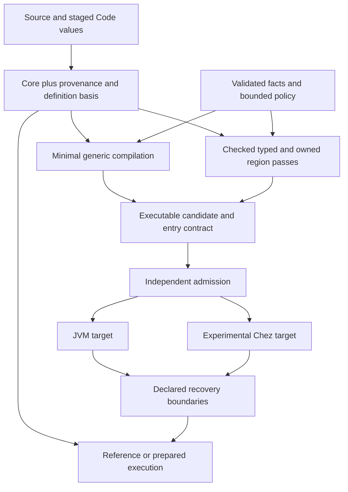

# Chez and a compiler framework for Klara

The subsequent [empirical study](CHEZ-EMPIRICAL.md) builds the exact revision
and measures compilation, native execution and AOT loading. It supersedes the
build-prerequisite limitation of this initial source review.

Review date: 2026-10-29. Proposed architecture and decision gates; no runtime
switch, dependency addition, or production compiler change accompanies this
review. Read alongside [the runtime alternatives review](ALTERNATIVES.md) and
[the runtime contracts](../../doc/engineering/runtime.md).

Klara should test a small compiler that removes guest dispatch before investing
in another general interpreter representation. Chez is a credible alternative
execution substrate for that experiment, and an instructive example of an
interactive system built around compilation. It does not by itself supply
Klara's persistent worlds or forkable application memory. The near-term JVM
experiment can reuse the existing emitter; a Chez experiment should remain a
separate, bounded backend investigation until its semantic and interoperability
costs are visible.

The framework worth establishing now is modest: explicit pass inputs and
outputs, subject-bound assumptions and evidence, immutable compilation jobs,
and a common description of entry and recovery. Pattern and Raster provide
useful implementation examples. They do not require one universal IR, a shared
runtime, or a migration of every existing pass.

Klara's own semantics and checked refinement obligations should decide what
these implementations mean. Neither a fast host nor a convenient pass library
defines the language. SCI is a useful performance comparator, not an adoption
proposal. The local forkable SCI variant is a separate implementation from the
published SCI 0.15.59 used in the measurements below. Forkability alone does
not establish Klara's continuation, authority or staging contracts; this review
does not establish which continuation facilities that local variant supplies.

## What Chez actually offers

The local checkout is `../ChezScheme`, not `../Chez`. Its inspected revision is
`fae51c278e4cb43d89bce43172c5c74ac6b23343`. Its README describes on-the-fly
native compilation, runtime compilation, proper tail calls, continuations,
and garbage collection of dynamically generated code. These are substantial
facilities that a new native Klara runtime would otherwise have to obtain or
build. They make Chez more than a model for rearranging an interpreter loop.
[Chez implementation overview](https://github.com/cisco/ChezScheme/blob/fae51c278e4cb43d89bce43172c5c74ac6b23343/README.md).

Two qualifications change how to investigate interactive latency:

- `compile-interpret-simple` defaults to true: expressions that create no
  procedures can use an interpreter path. Compiling a lambda is a better
  compiler probe than evaluating a constant arithmetic expression.
- Optimization levels 0, 1, and 2 produce the same safe code according to the
  documented controls; level 3 permits unsafe operations. Those numbers are
  not a baseline-to-optimizing tier hierarchy. `cp0-effort-limit`,
  `cp0-score-limit`, and the `run-cp0` hook expose more relevant controls over
  optimization work. They do not bound all expansion, allocation, or compilation
  costs. [Compiler controls](https://cisco.github.io/ChezScheme/csug/system.html).

The implementation makes the separation concrete. `s/compile.ss:1800–1829`
expands and validates, applies source optimization and related passes, and
selects simple interpretation or the backend. `s/cpnanopass.ss` has distinct
closure conversion, floating-point unboxing, trap insertion and calling
convention passes. Its final pipeline at approximately line 10900 is a useful
reading map. A layered compiler can therefore serve interactive work; the
number of named passes alone does not establish its latency.
[Compiler driver](https://github.com/cisco/ChezScheme/blob/fae51c278e4cb43d89bce43172c5c74ac6b23343/s/compile.ss#L1800),
[nanopass compiler](https://github.com/cisco/ChezScheme/blob/fae51c278e4cb43d89bce43172c5c74ac6b23343/s/cpnanopass.ss#L10900).

Chez owns its native stack representation, compiler, collector, and calling
conventions together. `c/schsig.c:49–130` implements continuation promotion and
stack-segment splitting. This is relevant to Klara's ownership and capture
design, but it cannot be transplanted as Java code that captures arbitrary JVM
locals. JVM compilation still needs explicit guest recovery state or a boundary
that forbids suspension across the compiled activation.
[Continuation implementation](https://github.com/cisco/ChezScheme/blob/fae51c278e4cb43d89bce43172c5c74ac6b23343/c/schsig.c#L49).

No Chez performance result is reported here. The checkout has portable boot
files but no built executable; no `scheme` or `chezscheme` executable was found
on PATH. Its `nanopass`, `zuo`, `zlib`, and `lz4` submodule directories are empty.
The documented out-of-source build would keep writes under a temporary
directory, but requires completing those prerequisites first. The review stops
before fetching dependencies or modifying the sibling checkout.
[Build instructions](https://github.com/cisco/ChezScheme/blob/fae51c278e4cb43d89bce43172c5c74ac6b23343/BUILDING).

## Three distinct uses of Chez

| Choice | What Klara would gain | What it would still need |
|---|---|---|
| Learn from Chez while staying on the JVM | Compile ordinary procedure bodies early; bound optional optimization; retain small explicit compiler stages | JVM entry, generic helpers, tail-call strategy, recovery maps and code-cache lifecycle |
| Emit Scheme for admitted Klara programs | Native procedure bodies, Scheme tail calls, Chez runtime and collector | Klara values and arithmetic, world resolution, host ABI, effect/control translation, provenance and admission |
| Move the general Klara runtime to Chez | A substrate that already supports native first-class continuations and runtime code generation | A substantial guest runtime port, persistent collections/state, authority, staging, tooling and Clojure/Java ecosystem compatibility |

The second option can evaluate the third without committing to it. A persistent
Chez worker accepting a small serialized program/data interface is a reasonable
experimental arrangement. Its results must include serialization and transport
separately from kernel time. It does not show that every Klara function should
cross a process boundary. Embedding Chez alongside the JVM through a native
bridge would introduce two heaps and another ownership/lifetime protocol; defer
that until a workload requires it.

Emitting Scheme is much smaller than forking Chez's compiler or generating its
internal IR. Start through documented Scheme interfaces. A custom Chez fork
would couple Klara to private representations and increase maintenance before
there is evidence that source emission is insufficient.

A direct compiler need not infer types everywhere. It can emit a branch for
Klara `if`, ordinary locals for lexical values, and calls to generic Klara
primitive helpers. That removes a category of dispatch even while arithmetic
remains boxed. A second step can introduce guarded primitive loops. This
distinction also appears in the V8 baseline discussion in
[the alternatives review](ALTERNATIVES.md).

## Why a Chez backend still needs a Klara runtime

**Values and evaluation.** Scheme truth treats only `#f` as false; Klara's
Clojure-style behavior includes nil. Application operand order must be emitted
explicitly with sequential bindings rather than assumed from a host Scheme
call. A Scheme exact integer is not a Clojure checked `Long`, and Chez fixnum
width is not the Java signed 64-bit integer domain. Generic Scheme arithmetic
can promote where Klara must throw. Ratios, BigInt, BigDecimal precision,
floating-point behavior, equality, hash keys and collection interfaces need
defined adapters. The first backend should admit a declared subset and reject
unsupported values before running them. Safe Chez compilation is necessary,
but does not establish those guest semantics.
[Scheme application and conditionals](https://www.scheme.com/tspl4/control.html).

**Code and worlds.** Do not implement a Klara world by mutating one Scheme
top-level environment. Keep an explicit immutable definition root; compiled
closures retain their code basis and resolve definitions according to the
guest rules. A new world can refer to new compiled procedures while old worlds
retain old ones. Code/source identity, definition evaluation generation, and
compiled artifact identity remain distinct. The current
[`world.clj`](../../src/klara/world.clj) and
[`core.clj`](../../src/klara/core.clj) already make important parts of that
distinction. A callable Scheme procedure is a cacheable implementation of a
guest code value, not the portable definition of that value.

Native closure layout also cannot silently define guest reachability. T0's
full captured environment prefix can cause an unused resource to remain
reachable and reject multi-shot capture. A Clojure or Chez compiler may omit
that unused variable from its native closure. Initially retain a canonical
Klara closure descriptor with the full authority-reachability envelope even
if the native body loads only used slots. Trim it only under a deliberately
validated observation contract, such as the admitted inert fragment. Native
closure optimization alone does not justify changing authority behavior.
The executable counterexample is
[`capture_contract.clj`](capture_contract.clj).

**Application memory.** Capturing a continuation does not copy the objects it
references. A mutable vector retained by two continuations can still be shared.
Forkable application state therefore needs the same managed-reference design
on Chez as on the JVM: stable reference identity, lookup through an active
state root, and an explicit policy for writes and conflicts. Persistent map
implementations and their costs must be supplied or selected; Chez's collector
does not turn mutable hash tables into persistent worlds. Private affine
regions can use mutable arrays while exclusively owned, with copy/seal or
validated sharing at publication and capture boundaries.

**Control and rights.** Chez provides multi-shot `call/cc` and `call/1cc`.
One-shot continuations can be promoted when captured by a multi-shot
continuation; they are not an implementation of Klara's affine authority
checker. Klara must retain its own shot counts, borrowed-resource scopes,
cleanup, cancellation, and live rights identities. Copying control must never
mint another authority registry or restore already-spent budget.
[Chez continuations](https://cisco.github.io/ChezScheme/csug/control.html).

Chez continuations are not automatically Klara's delimited lexical handlers.
A backend needs a translation for handler instances, resumption delimitation,
dynamic context and error propagation. Either demonstrate that translation or
initially run effectful control through an explicit guest continuation machine.
The latter could itself be compiled by Chez, but would retain some guest
dispatch. Full native continuation use and explicit portable recovery are
separate experiments.

**Foreign boundaries.** Chez detects attempts to return to stale foreign
contexts. Its documentation expressly discusses the difficulties of mixing
general continuations with foreign frames. This does not provide permission
to snapshot arbitrary C/JVM callbacks or replay external effects. Guest host
calls still need reentry contracts and declared opaque boundaries.
[Continuations and foreign calls](https://cisco.github.io/ChezScheme/csug/foreign.html).

**Durability and retention.** Generated machine code can be collected, but an
old world or live continuation can keep it reachable. Retention policy remains
an application/runtime concern. Chez compiled files are useful deployment
artifacts; `fasl-write` rejects objects containing procedures. It is not a
general serialization API for live closures and suspended programs. Preserve
guest Core, captures, schema versions, recovery state and required evidence;
reconstitute executable artifacts for a compatible target.
[Fasl representation](https://cisco.github.io/ChezScheme/csug/io.html),
[compiled files and linking](https://github.com/cisco/ChezScheme/blob/fae51c278e4cb43d89bce43172c5c74ac6b23343/IMPLEMENTATION.md).

The key runtime separation is therefore independent of the host:

```text
Execution context
  code basis       immutable definitions used by this activation
  state context    active managed-reference root / private region ownership
  rights context   live authority, cancellation and spending identities
  host context     declared dynamic settings and foreign boundary state
```

Old code can read current state in its active managed world. Pinning code does
not imply freezing every cell it can access. A speculative fork needs an
explicit state context and rights grant; its losing work still consumes budget.

## A compiler path on the JVM before another interpreter redesign

The experimental node engine is a useful low-preparation baseline and recovery
vehicle. The activation-program results do not justify making it the permanent
middle of every execution path. The scalar gap also does not imply that the
only next step is typed storage inside an interpreter.

The [current five-engine comparison](../baseline/CURRENT.md) sharpens that
point. Across three JVMs, the 10,000-iteration sum takes 120.9–123.8 microseconds
in published SCI, 2.000–2.157 milliseconds in prepared nodes, and 1.534–1.636
milliseconds in the activation engine. Their per-call allocation is close:
about 477 KB, 483 KB and 481 KB respectively. Similar allocation totals coexist
with roughly 12–18 times different latency. Allocation volume alone is
therefore a poor explanation or optimization target; dispatch, loop and call
organization deserve direct investigation. This cohort does not isolate which
mechanism causes the gap, and does not measure compiled Klara regions. Its
200-round interleaved warmup is a recorded protocol, not proof of steady state.

Run a controlled comparison with three modes over exactly the same admitted
closed fragment:

1. Prepared nodes, retaining the current semantics and admission.
2. Directly emitted procedure bodies using generic primitive operations and
   minimal lowering. This tests the value of removing guest dispatch.
3. Guarded primitive emission using the existing checked scalar/loop machinery.
   This measures the additional value of representation specialization.

Use [`compile.ir`](../../src/klara/compile/ir.clj),
[`compile.emit`](../../src/klara/compile/emit.clj), and the existing requirement
checks first. The current `compile.core/compile-def` includes several
optimization passes and transitive dependency handling; it is not yet a
minimal-latency baseline compiler. Its `:tested` certificate records test
provenance, not a test of every newly compiled user function. A minimal mode
must preserve admission and fallback obligations while avoiding optional
optimization work. It must not merely omit the checks that make emission safe.

Initially choose closed, noncapturing, pure functions and whole-call boundaries.
The existing emitter rejects some local closure and recursion shapes; report
coverage and declines rather than silently changing the workload. Then add one
high-value missing shape. For example, a direct local-call workload answers a
different question from a scalar loop alone.

This experiment does not require a new bytecode library. Clojure-form emission
already produces JVM methods. If parsing/macroexpansion, class construction,
boxed calling conventions or a specific code-generation limitation dominates,
compare a narrowly scoped direct bytecode emitter next. The Java-source route
in [`compile.staged`](../../src/klara/compile/staged.clj) invokes `javac` and
creates a temporary compilation directory; its preparation cost should not be
treated as a lower bound on JVM code generation.

Compilation does not remove the control problem. A direct JVM local is not an
inspectable guest slot, and HotSpot deoptimization is not a Klara continuation
API. General resumable compilation needs explicit caller state, a CPS/state
machine transformation, or materialization at supported safepoints. Likewise,
self-tail recursion can use a JVM loop; general mutual tail calls require
another strategy such as a trampoline or a compiled function group. Chez has
an advantage here because it owns a tail-call and continuation-aware ABI.

Keep the first compiled regions atomic with respect to guest suspension, with
declared cancellation/latency limits. Do not claim arbitrary capture inside
them. A later recovery ABI should describe source positions, next operation,
already-computed operands, logical locals/captures, handler scopes, code/mint
bases and ownership transfer. Guards after effects resume at that state; they
cannot restart the function. Preserve the existing
[bridge](BRIDGE.md) as evidence and a test oracle, not as a requirement that
every backend physically allocate CEK frames.

Interactive compilation should be selected by measured total cost. Let
`P` be incremental compile/validate/install cost, `I` interpreted call cost, and
`C` compiled call cost. For a stable workload with `I > C`, the elementary
break-even count is `P / (I - C)`. Include invalidation, retained code, warmup,
fallbacks and lost speculation when turning that estimate into policy. A cold
one-off expression may remain interpreted; a known initialization loop can
justify compilation on its first invocation. Compile-by-default for procedures
is a policy hypothesis to measure, not a prerequisite for a coherent language.

## What to take from Pattern and Raster

Inspected Pattern revision:
`89da31a64f5150a180a1233cd13fa1de4f42e416`.
Inspected Raster base revision:
`1c47d3e3729f402944487c1c78e723fb61a1449b`, with local modifications including
`src/raster/compiler/pipeline.clj`. Raster observations below describe the
local working tree, not an assertion about that exact committed revision.

Pattern supplies dialect declarations and validators in
`src/pattern/nanopass/dialect.clj`, and `defpass`/mutually recursive rule
machinery in `src/pattern/nanopass/pass.clj`. It compiles reusable matchers and
provides explicit traversal through dialect forms. These mechanisms can reduce
handwritten traversal boilerplate and make a pass's intended syntax visible.
[Pattern dialect implementation](https://github.com/pangloss/pattern/blob/89da31a64f5150a180a1233cd13fa1de4f42e416/src/pattern/nanopass/dialect.clj),
[pass implementation](https://github.com/pangloss/pattern/blob/89da31a64f5150a180a1233cd13fa1de4f42e416/src/pattern/nanopass/pass.clj).

Pattern's `all-dialects` is a process-global atom, and its pass definitions
use hosted macros and functions. That is convenient development infrastructure,
not already a forkable compiler world. Resolve and pin the dialect descriptors,
pass implementation identities and their dependencies in a compilation job;
avoid consulting a changing global registry halfway through a pinned job.
Self-hosted or durable pass values would require a later representation bridge.

Raster demonstrates an especially useful separation:

- `src/raster/compiler/pipeline.clj:1037–1101` declares pass input/output
  dialects and checks adjacent compatibility in `run-passes`.
- `pipeline.clj:209–250` distinguishes structural checking from deeper
  invariants, independently of whether a pass uses Pattern or a direct walker.
- `src/raster/compiler/ir/dialects.clj` defines grammars, while separate
  representations describe kernel artifacts, ABI, invocation and linking.

That is a sound organizational lesson: retain semantically important boundaries
even when implementations use different traversal techniques. It is not proof
that the resulting computation is equivalent. Raster's flexible `:from :*`
passes, optional deep checks and warning-only invariants illustrate why Klara's
semantic admission cannot reduce to an arrow compatibility test.

Do not transplant Raster's numerical rules wholesale. For example, the local
`passes/scalar/simplify.clj` contains algebraic reductions involving zero and
repeated expressions. A rewrite such as `(* x 0) -> 0` requires a suitable
numeric and observation contract: it can otherwise remove an exception or
effect while evaluating `x`, or change NaN behavior. Klara's exact/checked
arithmetic and host semantics need their own rules and evidence. Shared rule
syntax does not establish shared arithmetic semantics.

The useful scope of nanopass is a sequence of small languages with explicit
changes and generated traversal support. It improves localization and testing
of compiler changes; it neither supplies semantic proofs nor promises cheap
compilation. Full validation and repeated whole-tree allocation can be
expensive. Measure pass cost, keep bounded fixed points, and later fuse physical
traversals while retaining their logical contracts and diagnostic boundaries.
[Keep's nanopass dissertation](https://andykeep.com/pubs/dissertation.pdf).

## Minimal framework to establish now

Start with records/maps and ordinary functions around existing code. No new
dependency is needed to establish the contracts. Pattern can be evaluated for
one transformation when its syntax or traversal generation demonstrably helps.
Do not recreate Pattern as a general-purpose library inside Klara.

| Item | Minimum meaning |
|---|---|
| Program artifact | Existing Core/source identity, dialect/schema version, source provenance and exact constant representation |
| Pass descriptor | Versioned implementation identity, accepted/produced dialects, required facts, changed properties, budget and declared observation contract |
| Compilation job | Immutable input artifacts, pinned compiler/definition world, target ABI, options, available facts, requested result and cost limit |
| Pass result | New artifact, dependencies/assumptions, evidence references, source/recovery mapping and measured cost; or an explicit decline |
| Executable candidate | Entry contract, target/runtime identity, generic fallback, guarded assumptions and recovery boundaries |
| Admission | Application-selected validation policy, independently checked dependencies/evidence, and atomic publication against the intended base |

These are conceptual fields, not a proposal to introduce six mandatory class
hierarchies. Use the existing executable, certificate, requirement and prepared
candidate structures where they already express them. Add a field only where
an actual pass or backend requires it.

Three rules prevent this framework from becoming a source of unsoundness:

1. **Facts name their subject and scope.** A bound belongs to an exact value,
   Core fragment or binding at a program point, with a numeric domain and
   dependencies. A profile is a cost observation, not a type proof. Rewriting
   invalidates affected facts unless the pass supplies a checked transport.
2. **Evidence names its strength.** Grammar validation, structural invariants,
   differential tests, a checked theorem and an emitter's trusted bridge are
   different forms of evidence. Composition must match exact endpoints and
   observations. A tested pass is not automatically a proof-producing pass.
3. **The proposer does not select its own acceptance policy.** A compiler
   changed in a speculative world can propose artifacts. The accepting
   application's policy decides which checker versions and obligations count.
   A new compiler world must not weaken that policy by publishing a permissive
   checker alongside its candidate.

Reuse Core as the stable semantic anchor. Reuse named K1 for admitted ordinary
transformations, and the existing typed/owned region representations for their
declared subsets. A future control/recovery representation should appear only
when compiled resumable control needs it. Chez source, JVM methods and native
region layouts remain target-specific products. There is no requirement that
Pattern, Raster, the CEK, and every backend share one execution IR.



The arrows describe responsibilities, not a mandate to implement a single
dispatcher or registry now. Small explicit pass sequences are sufficient.
Automatic pass-order search, a universal optimization graph and a generalized
backend plugin system are premature. A bounded policy can select among named,
validated pipelines without solving those larger problems.

## The first refinement theorem and its implementation boundaries

The first correctness milestone should connect a useful lowering to an
existing checked model, with a named obligation for every remaining bridge.
It should not be another optimizer justified only by final-answer agreement.
Start with the finite scalar fragment already formalized in
[`scalar_core.clj`](../../verification/consolidation/scalar_core.clj),
[`scalar_cek.clj`](../../verification/consolidation/scalar_cek.clj) and
[`scalar_finite.clj`](../../verification/consolidation/scalar_finite.clj): nonnegative literals,
finite de Bruijn locals, sequential `let`, addition and multiplication with an
explicit intermediate cap. Its successful answers and overflow outcome are
sufficient for a first theorem; it does not include general signed arithmetic,
closure graphs, globals or effects.

Model the ordered bindings and primitive calls that the existing emitter
produces as a small target language. Allocate a fresh slot for each binding
and intermediate result initially; omit slot reuse, reassociation, inlining
and other optional optimizations. This is a proof model of an emitted block,
not a new runtime bytecode interpreter or a universal IR. Operands are computed
left to right and a failing operation prevents later operations from executing.

The proposed first kernel-checked statement is:

```text
Scoped(p, length(rho)) and InputsWithinCap(rho, cap)
  imply
observe(runBlock(lower(p), encodeEnv(rho), cap))
  = scalarFiniteChecked(p, rho, cap)
```

Here `observe` distinguishes a successful exact answer from the declared
overflow failure; `runBlock` checks every arithmetic intermediate. The cap and
input domain are explicit premises. This is not a theorem about arbitrary
Clojure numeric representations or every exception attribute.
The first JVM instantiation uses exact nonnegative `Long` inputs and
`Long/MAX_VALUE` as the cap; the representation bridge must check that choice.

Prove the following pieces in order:

1. **Binding and slot correctness.** Lowering yields a well-formed block; each
   source lookup selects its corresponding initialized slot, and `let` extends
   that correspondence without capture or premature writes.
2. **Ordered execution refinement.** A block transition preserves the relation
   between computed operands, pending source work and the finite scalar CEK.
   Return and overflow agree. Administrative transitions have a decreasing
   measure, preventing an implementation from satisfying a vacuous stuttering
   relation while never completing.
3. **Composition.** Combine that result with the existing finite-environment
   and scalar CEK results. Use exact matching source/target endpoints and the
   same cap; do not substitute an unrelated accepted arithmetic theorem.

The existing model files already establish scalar transition/meaning,
termination-budget and finite-environment statements. The lowering theorem
above is proposed work. Even when it is checked, three implementation
boundaries remain visible:

| Boundary | Required connection |
|---|---|
| Actual Core to scalar model | Exact constructor/binder decoding, numeric representation, input layouts and primitive identity; bind the witness to the actual source |
| Scalar model to T0 | Show that admitted actual Core and concrete T0 transitions implement the model's values and selected errors; this is not supplied by naming the model “CEK” |
| Target block to JVM or Chez | Establish emitted operation order, checked arithmetic, slot representation, entry/exit conversion and exception mapping; then state the remaining host compiler/runtime trust |

For the first implementation, use a small structural translation checker to
compare the emitted block with the source-directed lowering and reject stale
or mismatched witnesses. Such a checker also needs its own soundness argument;
being separate from the optimizer is valuable but not a theorem. Use boundary
and mutation tests while those host bridges remain trusted. The milestone is
complete only when its report lists the kernel-checked statement, assumptions,
imported proof environment and remaining trusted implementation together.
The current proof environment imports Init in TRUST mode; complete independent
Lean replay is still open. See the
[correctness ledger](../../doc/engineering/correctness.md).

Then extend the result where the performance experiment needs it. A finite
counted-loop driver can reuse the existing driver models; signed checked-Long
operations need their own representation/error theorem. Add generic calls and
closures only with a graph relation that preserves aliases and the full
capture envelope. General recursion requires a progress/divergence argument,
not an assumed termination bound. The existing
[private-to-T0 bridge tests](BRIDGE.md) supply counterexamples and empirical
state matching for that work, not the missing simulation theorem.

Freeze/thaw correctness is a further theorem: two thaws of a frozen related
state preserve the relation and cannot interfere through private mutable
storage. Effects, handlers, managed references and authority require trace and
lifecycle observations beyond the scalar theorem. Add them as explicit
extensions; do not make full native continuation capture a prerequisite for
proving a useful closed compiled region.

This also gives pass contracts a concrete purpose. A descriptor names its
source/target language, relation and assumptions; its result carries the actual
endpoints and evidence. Pattern can implement the transformation, but grammar
acceptance discharges only its shape obligation. A faster compiler policy may
choose a different implementation while the same independent relation and
acceptance policy remain in force.

## Persistent compiler state and compositional staging

A compilation is a program operating on code, facts and a target description.
AOT preparation and runtime optimization can invoke the same transformations
with different facts and budgets. AOT does not magically discharge runtime
world, host or authority requirements. Conversely, a runtime profile can guide
which optimization to try without becoming part of its correctness argument.

Keep `code`, `esc`, `run`, and let insertion governed by the existing staging
semantics. A generic compiler must not descend into a quoted/generated stage
as though it were executing now. Static evaluation must use the right world,
binding locus and effect permissions. For the first backend, unsupported stage
boundaries stay in the reference evaluator; subsequent lowering must preserve
the same compositional meaning. A code generator's ability to emit valid Core
does not establish that its residual computes the reference result.

A compiler job can be made forkable before arbitrary native activations are
durable. Checkpoint between passes as immutable artifacts plus a remaining
plan, explicit symbol supply, dependencies and budget receipts. A worker may
use private mutable worklists internally, then publish a sealed result. If
mid-pass suspension becomes useful, represent that particular worklist and
cursor explicitly. Do not serialize a host call stack or an arbitrary closure
that happens to implement the pass.

Pinned compiler identity must include dependencies used by expansion, analysis,
validation and emission. Cache keys additionally need input identity, facts,
options, target/ABI and relevant host/numeric assumptions. Source hash alone
is insufficient: the same Core can depend on a different primitive generation
or dynamic math context. Keep provenance/source maps even when runtime shape
is smaller; required evidence and captures must survive with pinned artifacts.

This provides a gradual route to self-hosting. First expose immutable job
inputs/results and plain pass functions. Move selected policies and analyses
into Klara when useful, then transformation passes. Keep the seed expander,
backend and independent checking boundary explicit until their replacements
are justified. The framework need not run its own compiler metacircularly to
make compiler values versioned and inspectable.

## Decision experiments and stopping conditions

**First, compare existing JVM paths.** Measure preparation, first invocation,
short bursts and warmed execution for the three modes above. Include small
closures/local calls, nested and non-tail calls where admitted, scalar loops,
persistent vector updates and source-size growth. Record admission failures,
fallback cost, allocation, class/code retention and recovery cost separately.
Run multiple isolated JVM cohorts sequentially; use a retained development
REPL for implementation work. Keep mathematical arithmetic, checked `Long`
and exact collection workloads distinguishable.

The decision is whether a useful admitted workload reaches break-even within
its observed lifetime and fits an explicit interactive latency/memory budget.
Proposed pilot thresholds, to fix before measurement: no unexplained semantic
mismatch; no replay after effects; preparation reported at median and tail;
and at least two nontrivial workload families improving total cost at measured
call counts. A native-looking sum result alone does not earn a general runtime
change. If generic compilation is expensive and typed regions win, retain
selective compilation. If generic compilation wins early, test broader
procedure coverage before making it the default.

**Second, test framework value on one real pipeline.** Wrap the existing
named/lower/emit path with pass identities, boundary validators and explicit
result metadata. Add no backend and no new optimizer. Check malformed input,
wrong facts, stale world dependencies and provenance/recovery preservation.
Compare diagnostics and compile allocation/time against the unwrapped path.
Adopt the small contract if it localizes failures at acceptable cost. Evaluate
Pattern on one existing pure transformation separately; a dependency decision
should follow that comparison, not precede it.

**Third, when a complete Chez build is available, run a retained-worker probe.**
Use compiled procedures, safe optimization settings, recorded compiler controls
and several program sizes. Separate frontend/translation, Chez compilation,
first call, repeated execution and data transport. Compare generic checked
operations and admitted specialized operations separately. Test overflow,
nil/false branching, left-to-right exceptions, old/new world resolution and
retained closures. A hand-written Scheme fixnum sum is a backend ceiling probe,
not a Klara benchmark.

Only then add a small control/memory cohort: resume a continuation twice,
observe deliberately shared mutable state, test an explicitly forked managed
root, preserve aliases, and retain/release old code worlds. Include a one-use
rights token and a foreign-call refusal case. These cases expose the difference
between native control capture and application-state isolation. Measure
retained heap/code after release as well as allocation while running.

Consider a general Chez-hosted runtime only if that pilot shows an important
total-cost advantage, useful language coverage, a credible persistent
collection/state implementation, and a practical Clojure/Java interop story.
If it does not, preserve it as a second target or stop it. The shared semantic
and artifact contracts should make either outcome inexpensive for Klara's
architecture.

The immediate design commitment is the semantic boundary, not a substrate:
versioned code and facts, explicit state/authority contexts, checked admission,
and recoverable control where promised. Those commitments support a better JVM
compiler now and leave a serious path to Chez or another target later.
